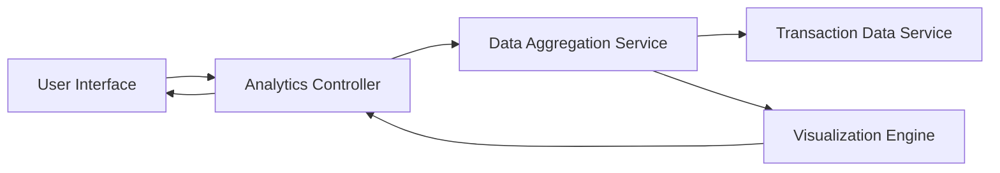

### 1. High-Level Design

**Summary:**  
This epic delivers an interactive analytics module that visualizes spending patterns through category-wise analysis and monthly trend charts. The solution provides insights across nine predefined spending categories (Food & Dining, Fuel, Shopping, Travel, Entertainment, Utilities, Healthcare, Education, Miscellaneous) with card-wise breakdowns and time-series trend analysis to support data-driven financial decision-making.

**Component Flow:**

**Integration Points:**
- **Upstream:** Transaction data service for raw transaction data aggregation and category mapping
- **Downstream:** Chart library or visualization framework (e.g., D3.js, Chart.js) for rendering interactive graphs; Accessibility libraries for screen reader support

**Key Assumptions:**
- Transactions are pre-categorized in the source data or will be categorized using merchant-based rules; category mapping logic is maintained in the aggregation service
- Monthly aggregation is calculated on calendar month boundaries; historical data is available for at least 12 months for trend analysis

**NFR Highlights:**  
Analytics visualizations must render within 2 seconds; Charts must be interactive and responsive; Support data aggregation for multiple time periods; Visualizations must be accessible with screen reader support

### 2. Validation Report

**Requirements Coverage:**  
The design fully addresses the epic's requirements by incorporating category-wise visualization, monthly trend analysis, card-wise spend breakdowns, and interactive charting capabilities. The architecture supports the 2-second rendering requirement through efficient data aggregation and caching strategies. All nine spending categories are accommodated in the design. The visualization engine component ensures interactivity and responsiveness across devices. Accessibility requirements for screen reader support are explicitly acknowledged and will be implemented through the chosen visualization framework's accessibility features. The multi-period aggregation requirement is supported by the data aggregation service layer.