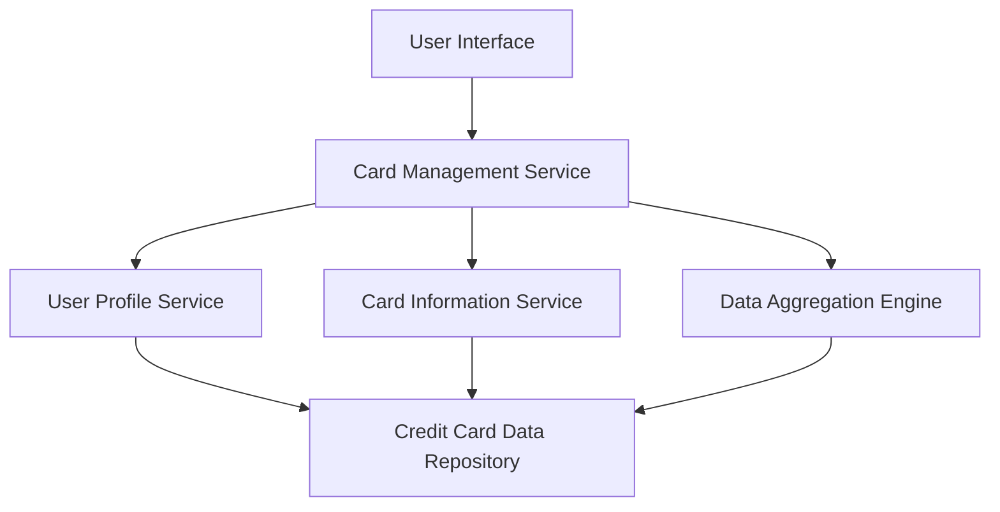

#### 1. High-Level Design

- **Summary:** This epic enables users to manage and monitor multiple credit cards (minimum 10 per user) from a unified interface, providing individual card detail views, card-wise spend analysis, monthly spending trends per card, and the ability to switch between cards with sub-500ms response time while maintaining aggregated portfolio metrics.

- **Component Flow:**

- **Integration Points:**
  - **Upstream:** Credit card data repository (stores individual card details, transaction history, and metadata), User profile service (maintains user-to-card associations)
  - **Downstream:** Card information service (retrieves card-specific details), Data aggregation engine (computes portfolio-level metrics and per-card analytics)

- **Key Assumptions:** 
  - Card data is stored in a normalized structure in the Credit Card Data Repository, indexed by user ID and card ID for fast retrieval to meet the 500ms card switching requirement.
  - Monthly spend trends are pre-calculated and cached for each card to optimize performance; trend calculations are refreshed daily.

- **NFR Highlights:** System must support minimum 10 credit cards per user; card switching response time must be under 500ms; interface must be responsive across all device types; data synchronization across cards must be consistent.

- **Data Flow:** User accesses the unified interface via the User Interface component. The Card Management Service retrieves the user's card portfolio from the User Profile Service, which queries the Credit Card Data Repository for associated card IDs. For each card, the Card Information Service fetches detailed card information (card number, issuer, type, limits). When a user selects a specific card, the Card Management Service retrieves card-wise spend analysis and monthly trends from the Data Aggregation Engine, which processes transaction data from the Credit Card Data Repository. The UI displays individual card details, spend analysis, and monthly trends. Users can switch between cards, triggering fast retrieval (under 500ms) of cached card-specific data. The portfolio overview aggregates metrics across all cards for consolidated viewing.

#### 2. Validation Report

- **Requirements Coverage:** The design fully addresses all scope requirements: Multiple credit card display, Card-wise spend analysis, Monthly spend trends per card, Individual card detail views, Card selection and switching interface, and Card portfolio overview. All NFRs are supported: minimum 10 cards per user (data model supports scalability), sub-500ms card switching (caching and indexing strategy), responsive interface (UI framework selection), and consistent data synchronization (transaction management in aggregation engine). All dependencies (Credit card data repository, Card information service, User profile service, Data aggregation engine) are integrated into the architecture. Out-of-scope items (bank integration, payments, fund transfers, loans, payment gateway, adding cards via bank APIs, card activation/deactivation) are appropriately excluded from the design.