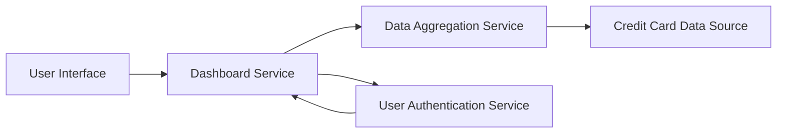

#### 1. High-Level Design

- **Summary:** This epic creates a consolidated financial dashboard that displays key performance indicators (Monthly Spend, Total Credit Limit, Available Credit, Outstanding Amount) across all user credit cards, providing real-time visibility into overall credit card financial health to support informed decision-making.

- **Component Flow:**

- **Integration Points:**
  - **Upstream:** Credit card data source system (provides individual card balances, limits, and transaction data), User authentication service (validates user identity and authorizes data access)
  - **Downstream:** Data aggregation service (calculates consolidated metrics across multiple cards)

- **Key Assumptions:** 
  - Credit card data is refreshed at regular intervals (assumed near real-time, within 5 minutes) from the upstream data source system.
  - Monthly Spend is calculated based on the current billing cycle; billing cycle dates are provided by the credit card data source.

- **NFR Highlights:** Dashboard must load within 2 seconds; system must support responsive layouts across desktop, tablet, and mobile devices; data accuracy must be maintained at 99.9%; support concurrent viewing by multiple users.

- **Data Flow:** User authenticates via the User Authentication Service. Upon successful authentication, the Dashboard Service requests consolidated financial metrics from the Data Aggregation Service. The Data Aggregation Service queries the Credit Card Data Source for individual card data (balances, limits, transactions). The service calculates aggregated KPIs: Total Credit Limit (sum of all card limits), Available Credit (sum of available credit across cards), Outstanding Amount (sum of outstanding balances), and Monthly Spend (sum of current month transactions). Aggregated metrics are returned to the Dashboard Service and rendered in the User Interface with real-time refresh capability.

#### 2. Validation Report

- **Requirements Coverage:** The design comprehensively addresses all scope elements: Monthly Spend display, Total Credit Limit calculation and display, Available Credit computation, Outstanding Amount tracking, Consolidated financial metrics view, and Real-time data refresh. All NFRs are explicitly supported: 2-second load time (through efficient aggregation service), responsive layouts (UI component design), 99.9% data accuracy (data validation in aggregation layer), and concurrent user support (stateless service architecture). All dependencies (Credit card data source system, User authentication service, Data aggregation service) are integrated into the component flow. Out-of-scope items (bank integration, payments, fund transfers, loans, payment gateway, historical trends) are appropriately excluded.