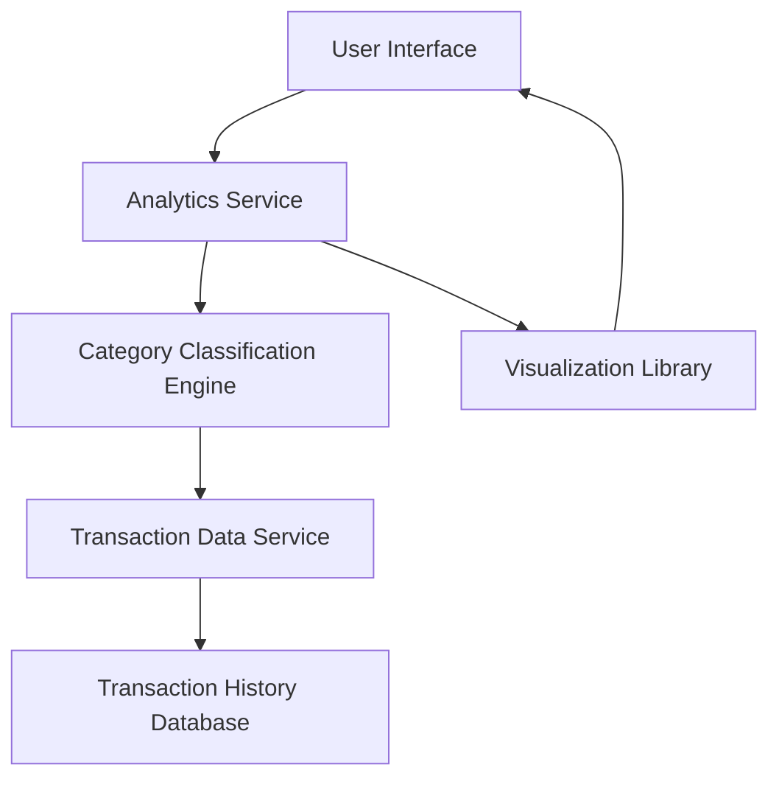

#### 1. High-Level Design

- **Summary:** This epic delivers an interactive analytics dashboard that categorizes credit card transactions into 9 predefined categories (Food & Dining, Fuel, Shopping, Travel, Entertainment, Utilities, Healthcare, Education, Miscellaneous) and provides visual representations to help users understand their spending patterns and make informed budget decisions.

- **Component Flow:**

- **Integration Points:**
  - **Upstream:** Transaction data service (provides raw transaction data), Transaction history database (source of transaction records)
  - **Downstream:** Visualization library (renders charts and graphs), Category classification engine (categorizes transactions)

- **Key Assumptions:** 
  - Transaction data arrives pre-structured with sufficient metadata (merchant name, transaction type) to enable category classification with 95% accuracy.
  - Category classification rules are predefined and maintained in a configuration service; no real-time ML-based categorization is required.

- **NFR Highlights:** Analytics visualizations must render within 3 seconds; system must handle transaction categorization with 95% accuracy; interactive charts must be responsive and touch-enabled for mobile devices; support for minimum 1000 transactions per user.

- **Data Flow:** Raw transaction data is fetched from the Transaction History Database via the Transaction Data Service. The Category Classification Engine processes each transaction and assigns it to one of 9 predefined categories based on merchant information and transaction metadata. The Analytics Service aggregates categorized transactions and calculates spending totals per category. The Visualization Library renders interactive charts (pie charts, bar graphs) displaying category-wise spending breakdowns. Users interact with the UI to filter, drill down, and explore spending patterns across categories.

#### 2. Validation Report

- **Requirements Coverage:** The design fully covers the epic's stated scope including category-wise visualization, interactive charts, transaction categorization, spending breakdown, category-based filtering, and support for 9 predefined categories. All NFRs (3-second render time, 95% categorization accuracy, responsive mobile interface, 1000+ transaction support) are addressed through appropriate component selection and architecture. Integration dependencies (Transaction data service, Category classification engine, Visualization library, Data analytics service, Transaction history database) are explicitly mapped in the component flow. Out-of-scope items (custom category creation, AI/ML categorization, budget alerts) are appropriately excluded from the design.