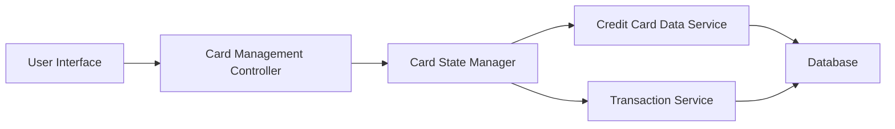

### 1. High-Level Design

**Summary:** This epic enables users to view and manage multiple credit cards (up to 10+ per user) within a unified interface. Users can switch between cards, view card-specific details including status, limits, and usage, and compare performance across their credit card portfolio with sub-500ms card switching performance.

**Component Flow:**

**Integration Points:**
- **Upstream:** Credit Card Data Service (provides card information and metadata)
- **Upstream:** Transaction Service (supplies card-specific spending data)
- **Data Flow:** Card selection triggers data retrieval for selected card details

**Key Assumptions:**
- Card data is pre-loaded or cached to achieve 500ms card switching requirement.
- Card comparison logic resides in the UI layer with data fetched from backend services.

**NFR Highlights:** System must support display of at least 10 credit cards per user; Card switching must occur within 500ms; UI must maintain consistent performance regardless of number of cards.

### 2. Validation Report

**Requirements Coverage:** The design addresses all scope elements including multiple credit card display, card-wise spend analysis, individual card details view, card comparison capabilities, and card selection/navigation. The Card State Manager component ensures efficient card switching to meet the 500ms NFR, while integration with Credit Card Data Service and Transaction Service provides comprehensive card and spending data. The architecture supports scalability for 10+ cards through optimized data loading and state management.