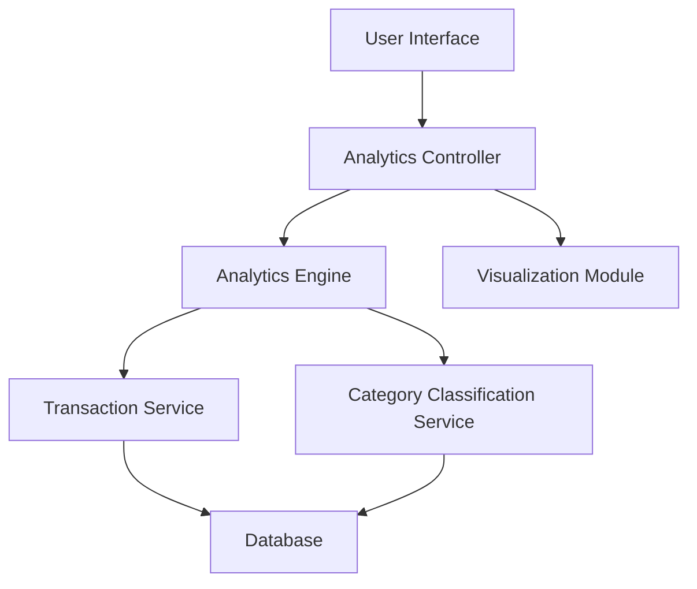

### 1. High-Level Design

**Summary:** This epic provides interactive visualizations and analytics for understanding spending patterns across nine predefined categories (Food & Dining, Fuel, Shopping, Travel, Entertainment, Utilities, Healthcare, Education, Miscellaneous). Users can view monthly spend trends, analyze category-wise breakdowns through charts and graphs, and identify spending patterns with interactive filtering and drill-down capabilities.

**Component Flow:**

**Integration Points:**
- **Upstream:** Transaction Service (provides transaction data and categorization)
- **Upstream:** Analytics Engine (performs data aggregation and trend calculation)
- **Upstream:** Category Classification Service (handles transaction categorization into 9 predefined categories)
- **Data Flow:** Interactive filtering triggers re-aggregation and chart re-rendering

**Key Assumptions:**
- Transaction categorization is automated via Category Classification Service; manual re-categorization capability is not specified.
- Historical data retention period for trend analysis is not defined; assuming minimum 12 months for meaningful monthly trends.

**NFR Highlights:** Analytics visualizations must render within 3 seconds; System must support interactive filtering and drill-down capabilities; Charts must be responsive and accessible across all device types.

### 2. Validation Report

**Requirements Coverage:** The design comprehensively covers all scope requirements including category-wise spending visualization, monthly spend trends analysis, interactive charts and graphs, spending pattern identification, and multi-category breakdown for all 9 specified categories. The architecture incorporates dedicated components for analytics processing (Analytics Engine), visualization rendering (Visualization Module), and transaction categorization (Category Classification Service). The 3-second rendering NFR is supported through pre-aggregated data in the Analytics Engine, while responsive design is handled by the Visualization Module. Interactive filtering and drill-down capabilities are enabled through the Analytics Controller coordinating between user actions and data re-aggregation.