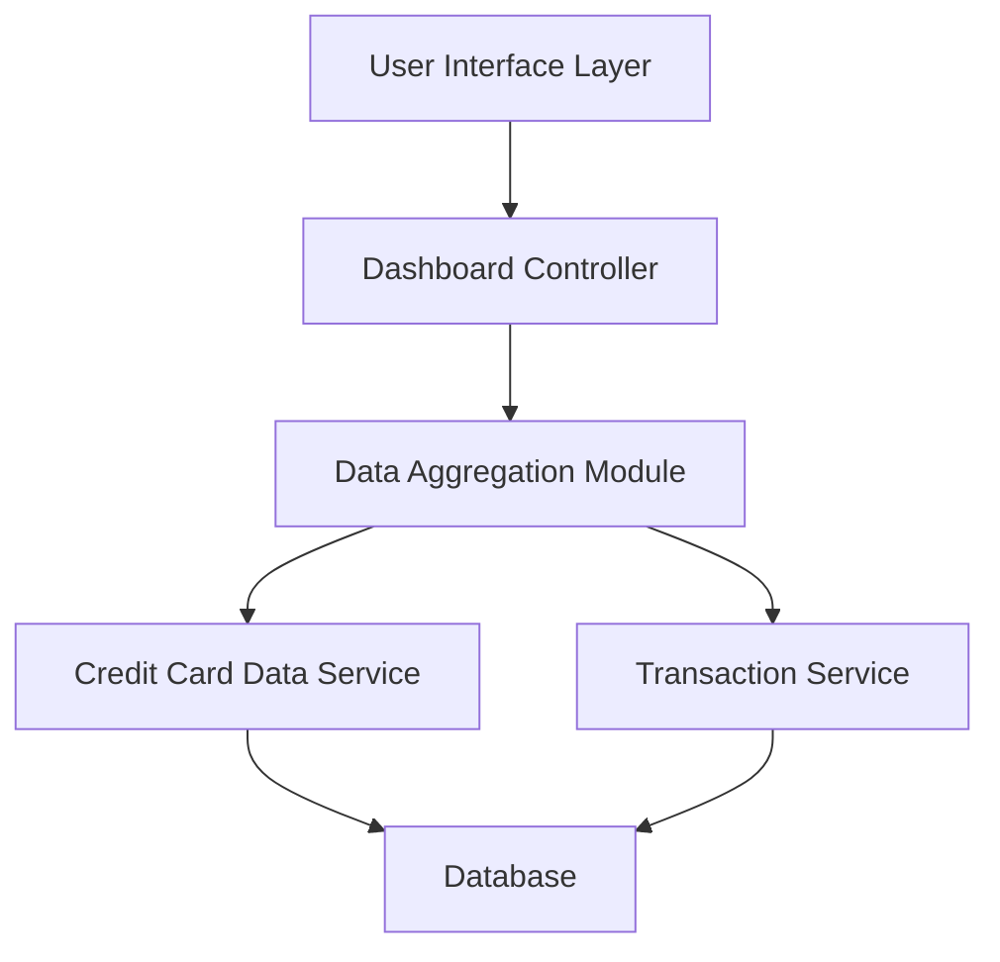

### 1. High-Level Design

**Summary:** This epic delivers a consolidated dashboard that displays key performance indicators (KPIs) for all credit cards in a single interface. The dashboard provides real-time visibility into monthly spend, total credit limit, available credit, and outstanding amounts, with a responsive design that adapts to desktop, tablet, and mobile devices.

**Component Flow:**

**Integration Points:**
- **Upstream:** Credit Card Data Service (retrieves card balances and credit limits)
- **Upstream:** Transaction Service (calculates monthly spend and outstanding amounts)
- **Data Flow:** Real-time data refresh mechanism for KPI metrics

**Key Assumptions:**
- Data refresh occurs via polling or event-driven mechanism (specific implementation not defined in epic).
- KPI calculations are performed server-side with cached results to meet 2-second load time requirement.

**NFR Highlights:** Dashboard must load within 2 seconds; System must support responsive design across desktop, tablet, and mobile devices; Real-time data refresh for KPI metrics.

### 2. Validation Report

**Requirements Coverage:** The design covers all stated requirements including dashboard KPI display, monthly spend tracking, total credit limit aggregation, available credit calculation, outstanding amount monitoring, and responsive UI layout. The component flow addresses integration with both required services (Credit Card Data Service and Transaction Service) and includes a data aggregation layer to consolidate metrics efficiently. The architecture supports the NFR requirements for 2-second load time through server-side aggregation and responsive design through a dedicated UI layer.