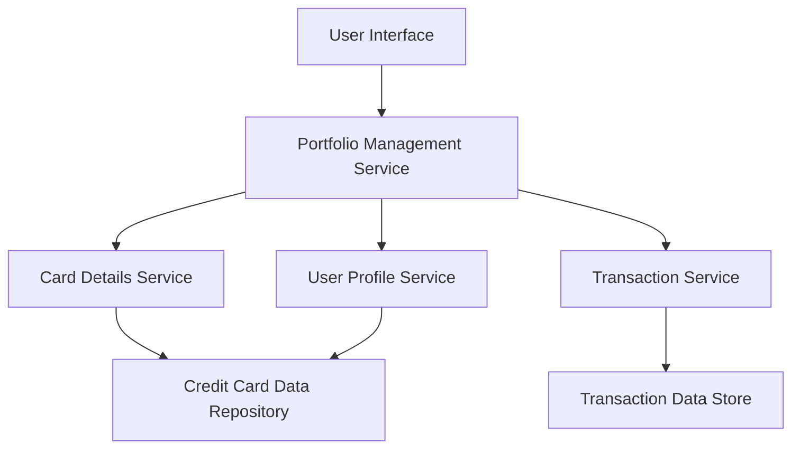

#### 1. High-Level Design

- **Summary:** This epic enables users to manage and monitor multiple credit cards (minimum 10 per user) within a centralized platform. Users can view all their credit cards, access card-specific details, perform card-wise spend analysis, and compare spending patterns across their portfolio. The solution provides individual card transaction listings and filtering capabilities to optimize card usage based on benefits and limits.

- **Component Flow:**

- **Integration Points:**
  - **Upstream:** Credit card data repository (stores card details and metadata), Transaction service (provides card-specific transaction history), User profile service (manages card-user mapping)
  - **Downstream:** Portfolio Management Service (orchestrates multi-card operations), Card Details Service (retrieves individual card information)

- **Key Assumptions:** 
  - Card-user mapping is maintained in User Profile Service with support for at least 10 cards per user; card ownership is verified at service layer.
  - Transaction data is indexed by card ID for efficient retrieval; card data includes limits, balances, and metadata for spend analysis.

- **NFR Highlights:** System must support minimum 10 credit cards per user, card data retrieval must complete within 1 second, ensure data privacy and security for sensitive card information.

- **Data Flow:** User requests portfolio view → Portfolio Management Service queries User Profile Service for card-user mappings → Card Details Service retrieves card information from Credit Card Data Repository for all mapped cards → Transaction Service fetches card-specific transaction history from Transaction Data Store → Portfolio Management Service aggregates card-wise spend analysis → User Interface displays multi-card view with filtering, selection, and comparison capabilities → User drills down into individual card details and transactions.

#### 2. Validation Report

- **Requirements Coverage:** The design fully addresses the epic's scope including multiple credit card display, card-wise spend analysis, individual card details view, card selection and filtering, and transaction listing per card. All NFRs are covered: support for minimum 10 cards per user is architected in the data model, 1-second card data retrieval is achievable through the service layer design, and data privacy/security for sensitive card information is ensured through proper service boundaries and authentication. Integration dependencies (credit card data repository, transaction service, user profile service) are explicitly mapped. The architecture supports the user value of centralized multi-card management and spending pattern comparison.