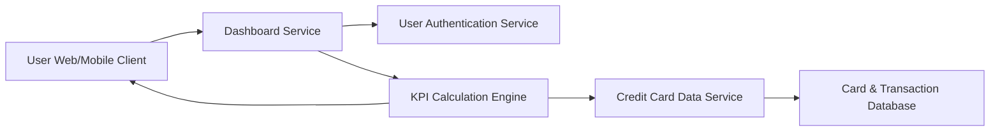

#### 1. High-Level Design

- **Summary:** This epic delivers a modern, responsive dashboard that serves as the primary entry point for users to monitor their credit card portfolio through key performance indicators (KPIs). The dashboard provides a consolidated, real-time view of critical financial metrics including monthly spend, total credit limit, available credit, and outstanding amounts across all credit cards, enabling users to quickly assess their financial health and credit utilization.

- **Component Flow:**

- **Integration Points:**
  - **Upstream:** Credit card data service (fetches card balances and transaction data), User authentication service (secure access control)
  - **Downstream:** Card & Transaction Database (real-time card and transaction data), KPI Calculation Engine (aggregates multi-card metrics)

- **Key Assumptions:** 
  - Credit card data service provides near real-time data feeds with acceptable latency for dashboard refresh; data is pre-aggregated at source where possible.
  - User authentication is handled by an external identity provider; session management supports both web and mobile clients.

- **NFR Highlights:** Dashboard must load within 2 seconds, support responsive design across desktop and mobile devices, handle real-time data refresh for KPI updates.

- **Data Flow:** User authenticates via Authentication Service → Dashboard Service validates session → KPI Calculation Engine requests data from Credit Card Data Service → Data Service queries Card & Transaction Database for all user cards → Engine calculates aggregated KPIs (monthly spend, total limit, available credit, outstanding) → Dashboard Service pushes KPIs to responsive UI → User views consolidated multi-card metrics with real-time refresh capability.

#### 2. Validation Report

- **Requirements Coverage:** The design comprehensively covers all stated scope elements including monthly spend KPI, total credit limit display, available credit calculation, outstanding amount tracking, responsive dashboard layout, and consolidated multi-card view. NFRs for 2-second load time, responsive design across devices, and real-time data refresh are addressed through efficient service architecture and KPI calculation engine. All integration dependencies (credit card data service, user authentication service) are properly mapped. The architecture supports the primary user value of instant financial position understanding and credit utilization management.