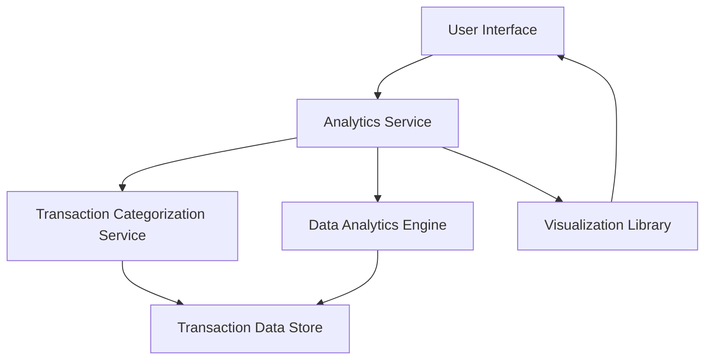

#### 1. High-Level Design

- **Summary:** This epic delivers an interactive analytics module that enables users to visualize and analyze their credit card spending patterns across nine predefined categories (Food & Dining, Fuel, Shopping, Travel, Entertainment, Utilities, Healthcare, Education, Miscellaneous) with monthly trend analysis. The solution provides actionable insights through interactive charts and graphs to support data-driven financial decisions and budget optimization.

- **Component Flow:**

- **Integration Points:**
  - **Upstream:** Transaction categorization service (maps transactions to spending categories), Data analytics engine (calculates trends and aggregations)
  - **Downstream:** Visualization library (renders charts and graphs), Transaction data store (historical transaction data for minimum 12 months)

- **Key Assumptions:** 
  - Transaction categorization is automated and pre-processed before analytics consumption; category mapping rules are maintained externally.
  - Historical transaction data is available in a queryable format with timestamps and category tags for at least 12 months.

- **NFR Highlights:** Analytics visualizations must render within 3 seconds, support interactive filtering and drill-down capabilities, handle historical data for minimum 12 months.

- **Data Flow:** User selects time period and filters → Analytics Service queries Transaction Data Store → Transaction Categorization Service provides category mappings → Data Analytics Engine aggregates spending by category and calculates monthly trends → Results passed to Visualization Library → Interactive charts/graphs rendered in User Interface with drill-down capabilities.

#### 2. Validation Report

- **Requirements Coverage:** The design fully covers the epic's stated scope including category-wise spending visualization across nine predefined categories, monthly spend trend analysis, interactive charts and graphs, and time-based spending comparisons. All NFRs (3-second render time, interactive filtering, 12-month historical data) are addressed through appropriate service layer separation and visualization library integration. Integration dependencies with transaction categorization service, data analytics engine, and visualization library are explicitly mapped in the architecture.