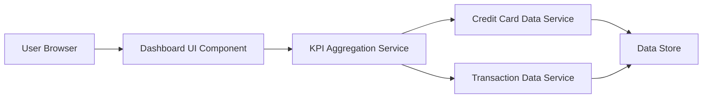

#### 1. High-Level Design

- **Summary:** This epic delivers a consolidated dashboard that displays key performance indicators (KPIs) for the user's credit card portfolio. The dashboard aggregates and presents critical financial metrics including monthly spend, total credit limit, available credit, and outstanding amounts across all credit cards. It provides users with an at-a-glance view of their overall credit card health through a modern, responsive interface.

- **Component Flow:**

- **Integration Points:**
  - **Upstream:** Credit card data service (for retrieving card information, balances, credit limits); Transaction data service (for calculating monthly spend and outstanding amounts)
  - **Downstream:** User authentication service (implied for user-specific data access)

- **Key Assumptions:** 
  - KPI calculations are performed server-side and cached for performance; data refresh frequency is not specified but assumed to be near real-time or on-demand.
  - Credit card data format follows a standardized schema with fields for limit, balance, and card identification.

- **NFR Highlights:** Dashboard must load within 2 seconds; must support responsive design for mobile and desktop devices; UI must be modern and intuitive.

#### 2. Validation Report

- **Requirements Coverage:** The design addresses all stated requirements including KPI display, monthly spend calculation, credit limit aggregation, available credit calculation, outstanding amount tracking, and responsive layout. The component flow shows clear separation between UI, aggregation logic, and data services, supporting the multi-card consolidated view. The 2-second load time requirement is achievable through service-side aggregation and efficient data retrieval patterns.