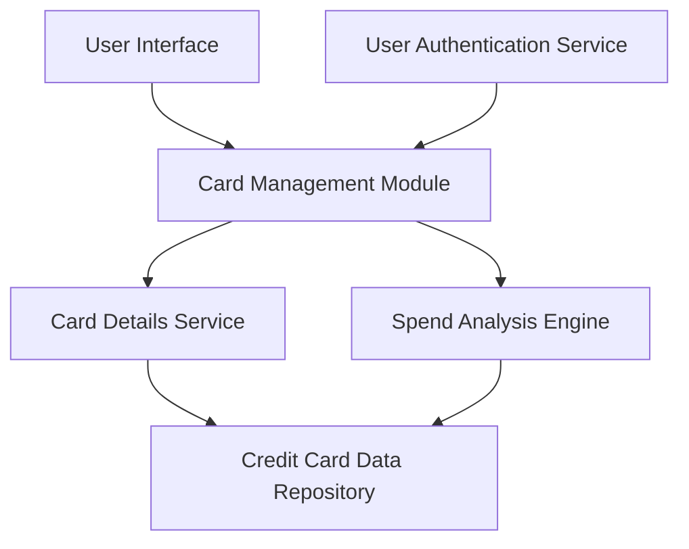

#### 1. High-Level Design

- **Summary:** This epic enables users to view and manage multiple credit cards within the dashboard. Users can access individual card details, perform card-wise spending analysis, and monitor card-specific metrics. The feature supports portfolio-level and individual card-level tracking, allowing users to compare performance and usage patterns across their credit card portfolio.

- **Component Flow:**

- **Integration Points:**
  - **Upstream:** Credit card data repository (for card details and metrics); User authentication service (for associating cards with authenticated users)
  - **Downstream:** Dashboard KPI components (for aggregated views)

- **Key Assumptions:** 
  - Card data is pre-associated with user accounts through a separate onboarding/linking process not covered in this epic.
  - Card-wise spend analysis aggregates transaction data by card identifier; calculation frequency and historical depth are not specified.

- **NFR Highlights:** System must handle display of up to 20 credit cards per user without performance degradation; card information must be displayed in a responsive grid or list format.

#### 2. Validation Report

- **Requirements Coverage:** The design covers all functional requirements including multiple credit card display, card-wise spend analysis, individual card details view, card listing and selection, and card-specific metrics display. The component architecture supports the NFR of handling up to 20 cards through efficient data retrieval and rendering strategies. The responsive grid/list format requirement is addressed through the UI layer design.