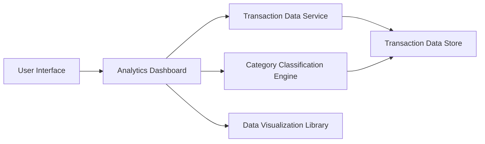

#### 1. High-Level Design

- **Summary:** This epic provides interactive visualizations and analytics capabilities to help users understand their spending behavior. Users can analyze transactions through category-wise spending breakdowns across nine categories (Food & Dining, Fuel, Shopping, Travel, Entertainment, Utilities, Healthcare, Education, Miscellaneous) and view monthly spend trend analysis. The feature enables pattern identification and supports data-driven financial decision-making.

- **Component Flow:**

- **Integration Points:**
  - **Upstream:** Transaction data service (for raw transaction data); Category classification engine (for categorizing transactions into predefined categories)
  - **Downstream:** Data visualization library (for rendering interactive charts and graphs); potentially integrates with the Dashboard KPIs epic for consolidated views

- **Key Assumptions:** 
  - Transactions are pre-categorized or categorized in real-time using the classification engine; manual recategorization is out of scope.
  - Monthly trend analysis covers a default time period (e.g., last 12 months); specific time range configuration is not detailed in the epic.

- **NFR Highlights:** Analytics visualizations must render within 3 seconds; system must support interactive filtering and drill-down capabilities; charts must be responsive and mobile-friendly.

#### 2. Validation Report

- **Requirements Coverage:** The design fully addresses the epic's scope including category-wise spending visualization, monthly spend trends analysis, interactive charts and graphs, transaction categorization, spending pattern identification, and multi-category analytics dashboard. The architecture separates concerns between data retrieval, categorization, and visualization, enabling the required interactive filtering and drill-down capabilities. The 3-second rendering requirement is achievable through optimized data queries and client-side visualization libraries.