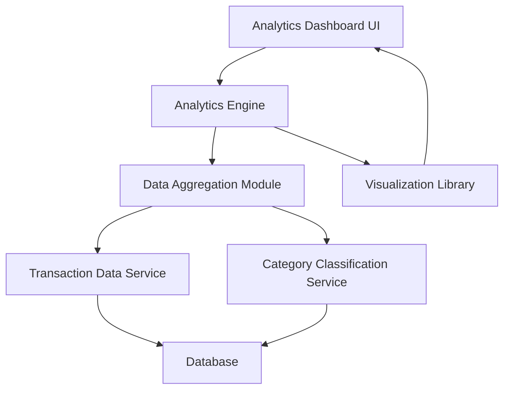

#### 1. High-Level Design

- **Summary:** This epic provides interactive visualizations and analytics for understanding spending patterns, including monthly spend trends, card-wise spending distribution, and category-wise breakdowns across nine predefined categories (Food & Dining, Fuel, Shopping, Travel, Entertainment, Utilities, Healthcare, Education, Miscellaneous).

- **Component Flow:**

- **Integration Points:**
  - **Upstream:** Transaction Data Service (spending data), Analytics Engine (data aggregation and calculation), Category Classification Service (transaction categorization)
  - **Downstream:** Interactive Analytics Dashboard with visualization library (e.g., Chart.js, D3.js)

- **Key Assumptions:** 
  - Historical data for up to 12 months is stored and indexed for efficient aggregation queries.
  - Category classification is pre-computed and stored with each transaction to ensure sub-second chart rendering performance.

- **NFR Highlights:** Visualizations must be interactive and responsive; charts must render within 1 second; system must support data aggregation for up to 12 months of historical data; analytics must reflect real-time data.

#### 2. Validation Report

- **Requirements Coverage:** The design comprehensively covers all scope elements including monthly spend trends, card-wise spend analysis, category-wise spending charts, interactive analytics dashboard, and spending pattern identification. The architecture supports the 1-second chart rendering requirement through pre-computed aggregations and efficient data retrieval. All integration dependencies are satisfied.