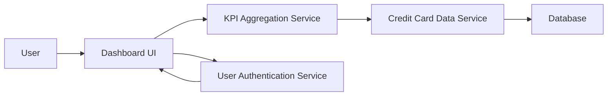

#### 1. High-Level Design

- **Summary:** This epic delivers a consolidated dashboard displaying all credit cards with key performance indicators (monthly spend, total credit limit, available credit, outstanding amounts). It provides a single interface for monitoring multiple cards simultaneously with a modern, responsive design.

- **Component Flow:**

- **Integration Points:**
  - **Upstream:** Credit Card Data Service (retrieves card details, balances, and limits), User Authentication Service (secure access control)
  - **Downstream:** Responsive Dashboard UI (displays KPIs across desktop, tablet, mobile)

- **Key Assumptions:** 
  - KPI calculations (available credit, outstanding amounts) are performed server-side by the KPI Aggregation Service based on real-time data from the Credit Card Data Service.
  - User authentication is token-based (e.g., JWT) and handled by a separate authentication service.

- **NFR Highlights:** Responsive design across desktop, tablet, and mobile devices; dashboard must load within 2 seconds; UI must follow accessibility standards (WCAG 2.1).

#### 2. Validation Report

- **Requirements Coverage:** The design fully addresses the epic's scope including KPI display, monthly spend tracking, credit limit aggregation, available credit calculation, outstanding amount monitoring, and responsive layout. The architecture supports the 2-second load time requirement through efficient data aggregation and caching strategies. All integration dependencies are covered.