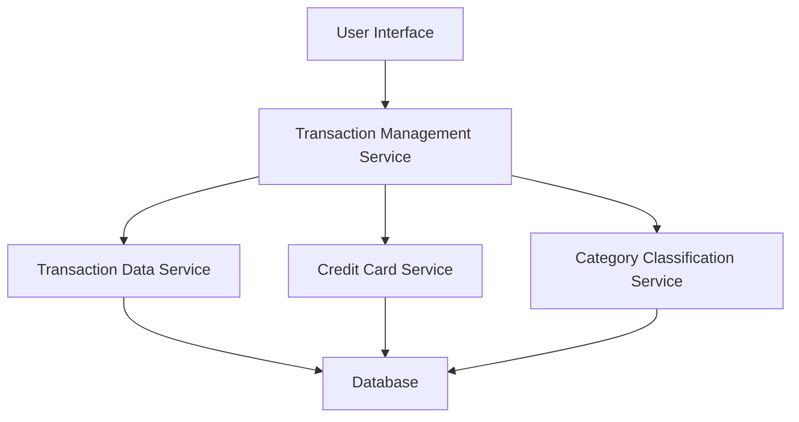

#### 1. High-Level Design

- **Summary:** This epic enables users to view, search, and filter credit card transactions across all their cards. It provides detailed transaction history with merchant information, amount, date, and category, ensuring complete transparency into spending activities.

- **Component Flow:**

- **Integration Points:**
  - **Upstream:** Transaction Data Service (retrieves transaction history), Credit Card Service (links transactions to specific cards), Category Classification Service (transaction categorization)
  - **Downstream:** User Interface (displays transaction data with search/filter capabilities)

- **Key Assumptions:** 
  - Transaction data is available in a standardized format from the Transaction Data Service with merchant, amount, date, and category fields.
  - Pagination will be implemented with a default page size (e.g., 50 transactions per page) to handle large datasets efficiently.

- **NFR Highlights:** System must handle multi-card transaction data efficiently with pagination support; data must be displayed in real-time or near real-time.

#### 2. Validation Report

- **Requirements Coverage:** The design covers all stated scope items including transaction listing, details view, multi-card aggregation, search/filtering, and categorization display. The architecture supports the NFRs for efficient data handling, pagination, and real-time data display. Integration points align with stated dependencies.