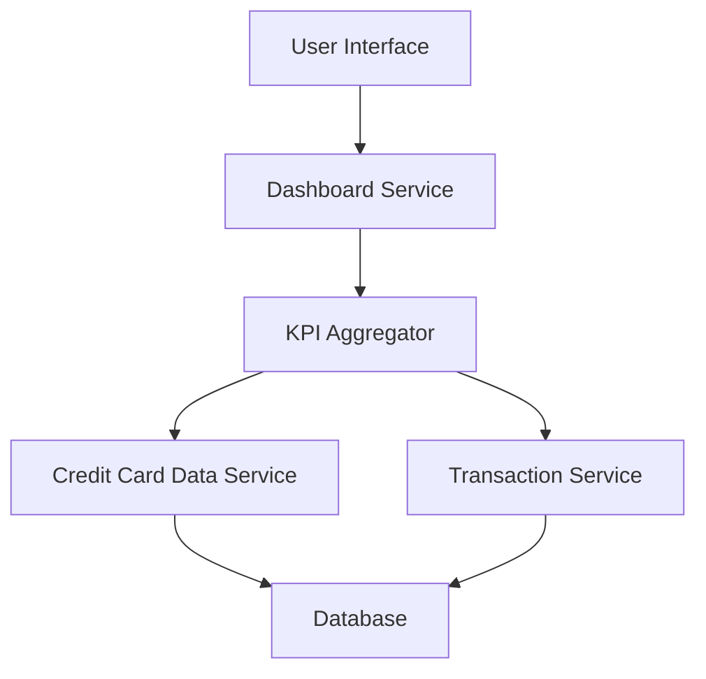

#### 1. High-Level Design

- **Summary:** This epic enables users to view a consolidated dashboard displaying critical financial KPIs including monthly spend, total credit limit, available credit, and outstanding amount across all their credit cards. The dashboard provides a single interface for users to monitor their overall credit card financial health at a glance with responsive design for cross-device accessibility.

- **Component Flow:**

- **Integration Points:**
  - **Upstream:** Credit Card Data Service (for retrieving card balances and limits)
  - **Upstream:** Transaction Service (for calculating monthly spend and outstanding amounts)

- **Key Assumptions:**
  - Real-time data refresh is achieved through periodic polling or event-driven updates from backend services
  - KPI calculations aggregate data across all user credit cards automatically

- **NFR Highlights:** Dashboard must load within 2 seconds, support responsive design for mobile and desktop devices, handle real-time data refresh for KPI updates

#### 2. Validation Report

- **Requirements Coverage:** The design fully addresses the epic's scope including monthly spend display, total credit limit calculation, available credit tracking, outstanding amount monitoring, responsive dashboard layout, and consolidated multi-card view. The architecture properly integrates with the credit card data service and transaction service as specified in dependencies. NFRs for performance (2-second load time), responsive design (mobile and desktop), and real-time data refresh are supported through the KPI aggregator component and service-oriented architecture.