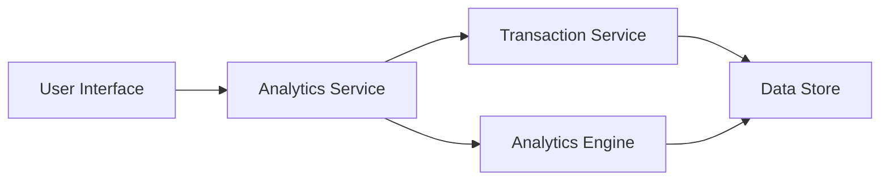

#### 1. High-Level Design

- **Summary:** This epic delivers interactive visualizations and analytics capabilities that help users understand their spending patterns through category-wise spending analysis and monthly spend trends. Users can view detailed breakdowns across 9 predefined categories (Food & Dining, Fuel, Shopping, Travel, Entertainment, Utilities, Healthcare, Education, Miscellaneous) to identify spending habits and make informed financial decisions.

- **Component Flow:**

- **Integration Points:**
  - **Upstream:** Transaction Service (for categorized transaction data)
  - **Downstream:** Analytics Engine (for trend calculations and pattern recognition)

- **Key Assumptions:**
  - Transactions are pre-categorized into the 9 predefined categories by the transaction service
  - Historical data retention policy supports at least 12 months of transaction history

- **NFR Highlights:** Analytics visualizations must render within 3 seconds, support interactive filtering and drill-down capabilities, handle historical data for at least 12 months

#### 2. Validation Report

- **Requirements Coverage:** The design comprehensively addresses the epic's scope including category-wise spending visualization, monthly spend trends, interactive charts and graphs, spending pattern analysis, multi-category breakdown, and transaction categorization. The architecture integrates with the transaction service and analytics engine as specified in dependencies. NFRs for performance (3-second render time), interactivity (filtering and drill-down), and data retention (12 months) are supported by the proposed component structure.