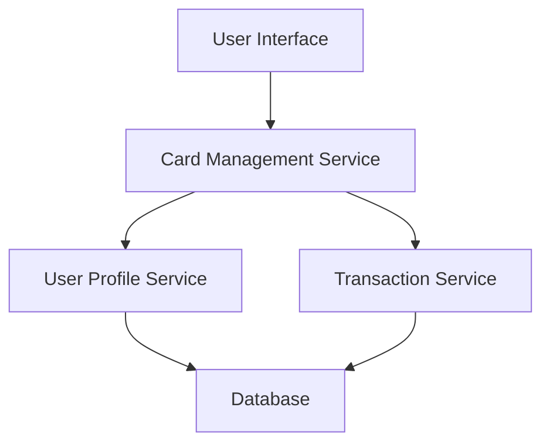

#### 1. High-Level Design

- **Summary:** This epic enables users to manage and view multiple credit cards within a single interface, providing card-wise spend analysis, individual card balance tracking, and card limit monitoring. Users can efficiently track which cards are being used most frequently and monitor individual card utilization rates.

- **Component Flow:**

- **Integration Points:**
  - **Upstream:** User Profile Service (for card registration and user data)
  - **Downstream:** Transaction Service (for card-wise spending data and transaction history)

- **Key Assumptions:**
  - Card data is stored in a normalized format with unique identifiers per card
  - Transaction categorization by card is already available from the transaction service

- **NFR Highlights:** System must support minimum 10 credit cards per user, card list must load within 1 second, support concurrent viewing of all registered cards

#### 2. Validation Report

- **Requirements Coverage:** The design fully covers the epic's stated scope including multiple credit card display, card-wise spend analysis, individual card balance tracking, card limit monitoring, and card selection/filtering. The architecture supports integration with user profile and transaction services as specified, and the NFRs for performance (1 second load time) and capacity (minimum 10 cards per user) are addressed through the service-oriented design.