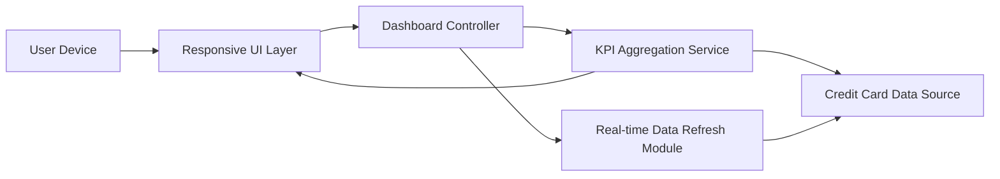

#### 1. High-Level Design

- **Summary:** This epic enables users to view a consolidated dashboard displaying key performance indicators (KPIs) for all credit cards in a single interface. Users can monitor critical financial metrics including monthly spend, total credit limit, available credit, and outstanding amounts across multiple cards through a modern, responsive interface that adapts to different screen sizes.

- **Component Flow:**

- **Integration Points:** 
  - **Upstream:** Credit Card Data Source or Mock Data Service (for retrieving card details, balances, credit limits, and outstanding amounts)
  - **Downstream:** Responsive UI framework (e.g., React, Angular, Vue.js) for adaptive layouts across devices

- **Key Assumptions:** 
  - Credit card data is available through a standardized API or mock service providing card details, balances, and limits.
  - Real-time data refresh is implemented via polling or push mechanism with configurable intervals.

- **NFR Highlights:** System must provide responsive layouts that adapt to mobile, tablet, and desktop screens; dashboard must load within 2 seconds; support for real-time data refresh of KPIs.

- **Data Flow:** User accesses dashboard → Responsive UI Layer detects device type and renders appropriate layout → Dashboard Controller requests KPI data → KPI Aggregation Service fetches data from Credit Card Data Source (card details, balances, limits, outstanding amounts) → Aggregated KPIs (Monthly Spend, Total Credit Limit, Available Credit, Outstanding Amount) are computed and returned → Dashboard displays consolidated view of all credit cards with KPIs → Real-time Data Refresh Module periodically updates KPIs without full page reload.

#### 2. Validation Report

- **Requirements Coverage:** The design fully addresses the epic's scope by providing dashboard KPI display for all four specified metrics (Monthly Spend, Total Credit Limit, Available Credit, Outstanding Amount), multiple credit card view, consolidated credit card overview, and responsive layout implementation. The architecture supports the NFRs for responsive design across mobile, tablet, and desktop screens, 2-second dashboard load time, and real-time data refresh capabilities. Integration with the credit card data source ensures availability of required card and financial data. The responsive UI layer ensures optimal user experience across all device types.