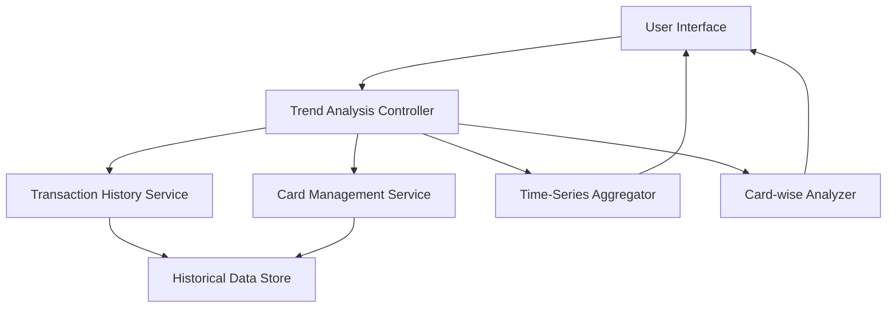

#### 1. High-Level Design

- **Summary:** This epic provides comprehensive monthly spending trend analysis and card-specific spending breakdowns. Users can track spending patterns over time, compare monthly expenditures, and analyze spending distribution across individual credit cards to understand card usage patterns and month-over-month spending evolution.

- **Component Flow:**

- **Integration Points:** 
  - **Upstream:** Transaction History Service (for time-series spending data), Card Management Service (for card-specific spending aggregation)
  - **Downstream:** Visualization components for trend display and card-wise comparison charts

- **Key Assumptions:** 
  - Historical data is retained for at least 12 months and is readily accessible for trend calculations.
  - Card-wise spending aggregation logic resides in the Card Management Service or is computed on-demand by the analyzer.

- **NFR Highlights:** System must retain and display at least 12 months of historical spending data; trend calculations must complete within 500ms; support concurrent analysis of up to 10 credit cards per user.

- **Data Flow:** User selects time period and/or specific cards → Trend Analysis Controller queries Transaction History Service for historical transactions and Card Management Service for card details → Time-Series Aggregator computes monthly spending totals and trends → Card-wise Analyzer breaks down spending by individual cards → Results are visualized showing monthly trends and card-specific spending patterns → User can compare months and analyze card utilization.

#### 2. Validation Report

- **Requirements Coverage:** The design comprehensively covers the epic's scope including monthly spend trend visualization, card-wise spend analysis, historical spending comparison, time-series spending data display, and individual card spending breakdown. The architecture supports the NFR requirements for 12 months of historical data retention, 500ms trend calculation performance, and concurrent analysis of up to 10 credit cards. Integration with Transaction History Service and Card Management Service ensures access to required time-series and card-specific data.