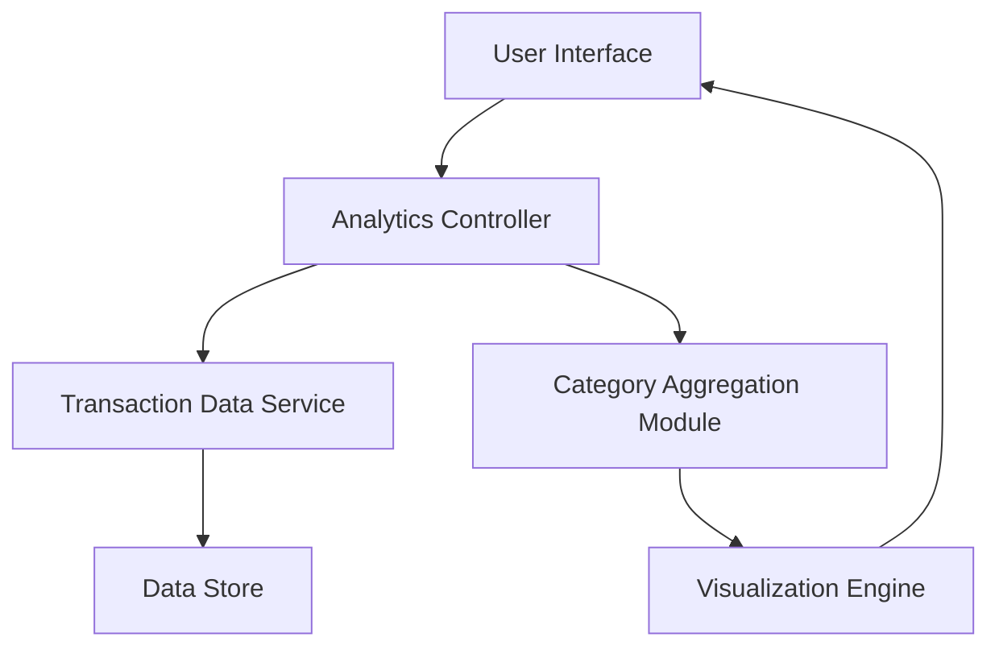

#### 1. High-Level Design

- **Summary:** This epic delivers interactive visualization capabilities for analyzing spending patterns across 9 predefined categories (Food & Dining, Fuel, Shopping, Travel, Entertainment, Utilities, Healthcare, Education, Miscellaneous). Users can explore category-wise breakdowns through visual representations to identify spending trends and make informed financial decisions.

- **Component Flow:**

- **Integration Points:** 
  - **Upstream:** Transaction Data Service (for category-tagged spending data)
  - **Downstream:** Charting library integration for visualization components (e.g., Chart.js, D3.js, or similar)

- **Key Assumptions:** 
  - Transactions are pre-tagged with categories by the transaction data service; no manual categorization is required in this module.
  - Category definitions are fixed to the 9 predefined categories; no dynamic category management is needed.

- **NFR Highlights:** Charts must render within 1 second; system must handle visualization of up to 1000 transactions per category; interactive elements must respond within 300ms.

- **Data Flow:** User requests spending analytics → Analytics Controller fetches transaction data from Transaction Data Service → Category Aggregation Module groups transactions by predefined categories → Visualization Engine renders interactive charts/graphs → User Interface displays category-wise spending breakdowns with interactive elements for drill-down analysis.

#### 2. Validation Report

- **Requirements Coverage:** The design fully covers the epic's stated scope by providing category-wise spending visualization across all 9 predefined categories, interactive charts and graphs, and spending pattern analysis. The component architecture supports the NFRs for rendering performance (1 second), transaction volume (1000 per category), and interactive responsiveness (300ms). Integration with the transaction data service ensures category-tagged data availability, and the visualization engine provides the required interactive capabilities.