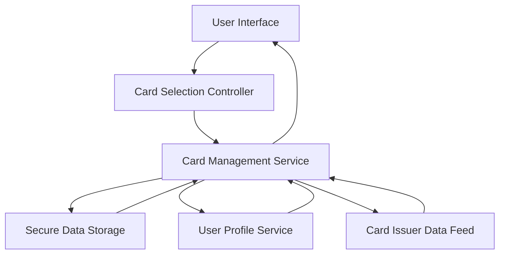

#### 1. High-Level Design

- **Summary:** This epic enables users to manage and view multiple credit cards within the application. Users can see all registered credit cards in one place, view individual card details, and switch between cards to analyze card-specific information. The feature provides a comprehensive card management interface that tracks each card's credit limit, outstanding balance, and available credit separately while maintaining an aggregated view across all cards.

- **Component Flow:**

- **Integration Points:**
  - **Upstream:** Secure data storage system (stores encrypted card information)
  - **Upstream:** User profile service (associates cards with specific users)
  - **Upstream:** Card issuer data feeds (optional integration for retrieving card details and updates)
  - **Downstream:** Card-specific analytics and detail views

- **Key Assumptions:**
  - Card data is encrypted at rest and in transit using industry-standard encryption protocols.
  - Card issuer data feeds provide standardized card information in a consistent format across different issuers.

- **NFR Highlights:** System must support a minimum of 10 credit cards per user; card data must be securely stored and encrypted; card selection and switching must be instantaneous with minimal latency.

- **Data Flow:** When a user accesses the card management interface, the card management service retrieves the user's profile from the user profile service to identify associated cards. The service then fetches card details (credit limit, outstanding balance, available credit) from the secure data storage system and optionally from card issuer data feeds for real-time updates. The aggregated card list is displayed in the user interface. When a user selects a specific card via the card selection controller, the service retrieves detailed card-specific information and sends it to the UI for display. All card data is encrypted during storage and transmission to ensure security.

#### 2. Validation Report

- **Requirements Coverage:** The design covers all scope items including multiple credit card registration and storage, individual card detail views, card listing and selection interface, card-wise spend analysis, per-card credit limit tracking, per-card outstanding balance display, and card switching functionality. The architecture supports the NFRs for supporting a minimum of 10 cards per user, secure storage with encryption, and instantaneous card selection and switching. Integration dependencies with secure data storage, user profile service, and optional card issuer data feeds are identified. Out-of-scope items (real bank integration, card payments, fund transfers, loans, payment gateway integration) are appropriately excluded.