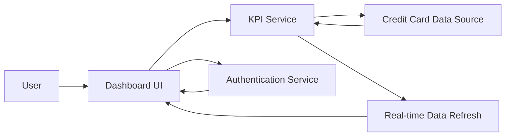

#### 1. High-Level Design

- **Summary:** This epic delivers a modern, responsive dashboard that provides users with a consolidated view of their credit card portfolio and key financial metrics. The dashboard displays critical KPIs including monthly spend, total credit limit, available credit, and outstanding amounts across all credit cards in a single unified interface, serving as the primary entry point for credit card financial health monitoring.

- **Component Flow:**

- **Integration Points:**
  - **Upstream:** Credit card data source or database (provides card details, balances, limits, and transaction data)
  - **Upstream:** User authentication service (ensures secure access to personal financial data)
  - **Downstream:** Real-time or near real-time data refresh mechanism for KPI updates

- **Key Assumptions:**
  - Credit card data source provides aggregated balance and limit information in a standardized format.
  - Real-time or near real-time data refresh is achieved through polling or push notifications from the data source.

- **NFR Highlights:** Dashboard must be responsive and support mobile, tablet, and desktop viewports; page load time must be optimized for quick access to financial data; UI must refresh KPIs in real-time or near real-time as data changes.

- **Data Flow:** Upon user authentication via the authentication service, the dashboard UI requests KPI data from the KPI service. The KPI service queries the credit card data source to retrieve card details, balances, credit limits, and transaction summaries for all user cards. The service calculates aggregated KPIs (total credit limit, available credit, outstanding amounts, monthly spend) and returns them to the dashboard UI. The real-time data refresh component periodically polls or receives push updates from the credit card data source, triggering KPI recalculation and UI updates to ensure users see current financial information.

#### 2. Validation Report

- **Requirements Coverage:** The design addresses all scope items including dashboard interface design and implementation, monthly spend KPI display, total credit limit aggregation, available credit calculation and display, outstanding amount tracking, responsive layout for multiple devices, and consolidated multi-card view. The architecture supports the NFRs for responsive design (mobile, tablet, desktop), optimized page load time, and real-time/near real-time KPI refresh. Integration dependencies with credit card data source and user authentication service are identified. Out-of-scope items (real bank integration, card payments, fund transfers, loans, payment gateway integration) are appropriately excluded.