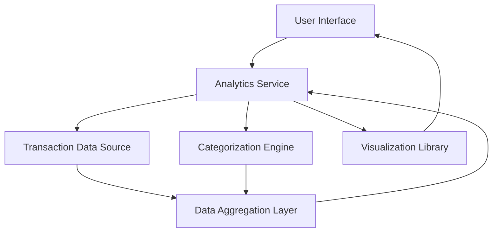

#### 1. High-Level Design

- **Summary:** This epic delivers a comprehensive spending analytics platform that enables users to visualize and analyze their credit card spending patterns across multiple categories (Food & Dining, Fuel, Shopping, Travel, Entertainment, Utilities, Healthcare, Education, Miscellaneous). The solution provides interactive visualizations, monthly trend analysis, and category-wise breakdowns to help users make data-driven spending decisions.

- **Component Flow:**

- **Integration Points:**
  - **Upstream:** Transaction data source or transaction management system (provides raw transaction data)
  - **Upstream:** Data categorization engine or service (classifies transactions into spending categories)
  - **Downstream:** Charting or visualization libraries (e.g., Chart.js, D3.js, Highcharts) for rendering interactive analytics

- **Key Assumptions:**
  - Transactions are pre-categorized or a categorization service provides real-time classification with high accuracy.
  - Historical transaction data is available and accessible for at least 12 months for trend analysis.

- **NFR Highlights:** Analytics visualizations must load within 2 seconds; system must handle historical data for at least 12 months; charts must be interactive and responsive across all device types; data aggregation must be accurate to 2 decimal places.

- **Data Flow:** Raw transaction data flows from the transaction data source to the data aggregation layer, where it is enriched with category information from the categorization engine. The aggregation layer processes and summarizes spending by category and time period (monthly trends). The analytics service retrieves this aggregated data and passes it to the visualization library, which renders interactive charts and graphs displayed in the user interface. Users can filter by card, category, or time period, triggering new data requests through the analytics service.

#### 2. Validation Report

- **Requirements Coverage:** The design covers all stated scope items including category-wise spending visualization, monthly spend trend analysis, interactive charts, transaction categorization, historical spending comparison, and card-wise spending analytics. The architecture supports the NFRs for performance (2-second load time), data retention (12 months), responsiveness, and accuracy (2 decimal places). Integration points with transaction data source, categorization engine, and visualization libraries are clearly identified. Out-of-scope items (real bank integration, payments, fund transfers, loans, payment gateway integration, predictive forecasts, budget alerts) are appropriately excluded from the design.