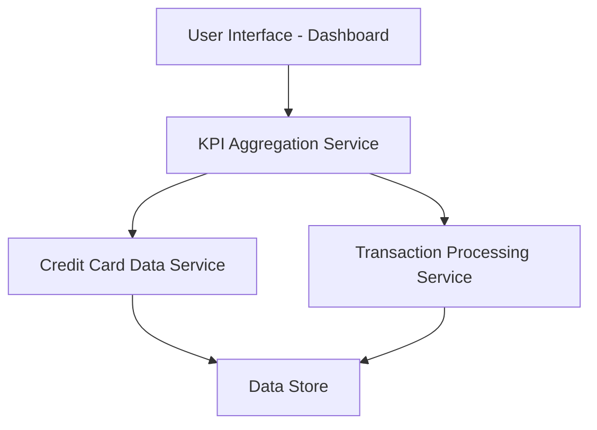

#### 1. High-Level Design

- **Summary:** This epic delivers a centralized, responsive dashboard that consolidates key performance indicators (KPIs) for credit card portfolios. Users can view monthly spend, total credit limit, available credit, and outstanding amounts in real-time, enabling informed financial decision-making through a single consolidated interface.

- **Component Flow:**

- **Integration Points:**
  - **Upstream:** Credit Card Data Service (provides card balances and credit limits); Transaction Processing Service (provides monthly spend and outstanding amounts)
  - **Downstream:** User Interface layer consuming aggregated KPI data

- **Key Assumptions:** 
  - KPI data is refreshed at regular intervals (assumed every 5-15 minutes for near-real-time updates); Data format follows standardized JSON schema for credit card metrics.

- **NFR Highlights:** Dashboard must be responsive across desktop, tablet, and mobile devices; KPI data must load within 2 seconds; System must support real-time or near-real-time data refresh.

#### 2. Validation Report

- **Requirements Coverage:** The design covers all stated scope elements including monthly spend display, total credit limit visualization, available credit tracking, outstanding amount monitoring, responsive dashboard layout, and consolidated multi-card KPI view. The component architecture supports the required integrations with credit card data and transaction processing services, and the design accommodates the specified NFRs for responsiveness and 2-second load time.