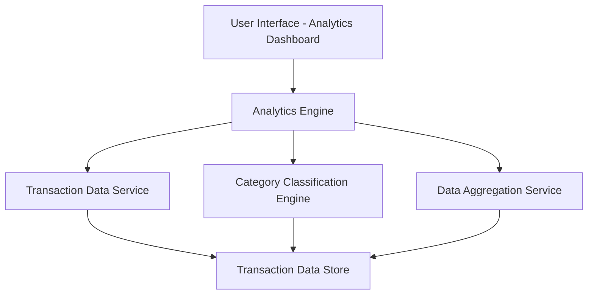

#### 1. High-Level Design

- **Summary:** This epic provides interactive visualizations and analytics capabilities for understanding spending patterns through category-wise breakdowns and monthly trends. Users can explore spending across 9 predefined categories (Food & Dining, Fuel, Shopping, Travel, Entertainment, Utilities, Healthcare, Education, Miscellaneous) with visual representations that enable data-driven financial decisions.

- **Component Flow:**

- **Integration Points:**
  - **Upstream:** Transaction Data Service (provides raw transaction records); Category Classification Engine (categorizes transactions); Data Aggregation Service (calculates trends and aggregates)
  - **Downstream:** Interactive visualization layer rendering charts and graphs for end users

- **Key Assumptions:** 
  - Transactions are pre-categorized by the classification engine before analytics processing; Monthly aggregations are computed and cached to meet 2-second rendering requirement.

- **NFR Highlights:** Analytics visualizations must render within 2 seconds; System must handle analysis of minimum 1000 transactions per user; Charts must be interactive and responsive across all device types; Data aggregation must be accurate to 2 decimal places.

#### 2. Validation Report

- **Requirements Coverage:** The design comprehensively covers all scope elements including category-wise spending visualization, monthly spend trend analysis, interactive charts and graphs, spending breakdown by predefined categories, transaction-based analytics, and spending pattern identification. The architecture integrates with all specified dependencies (transaction data service, category classification engine, data aggregation service) and supports the demanding NFRs for 2-second rendering, 1000+ transaction handling, cross-device responsiveness, and decimal precision.