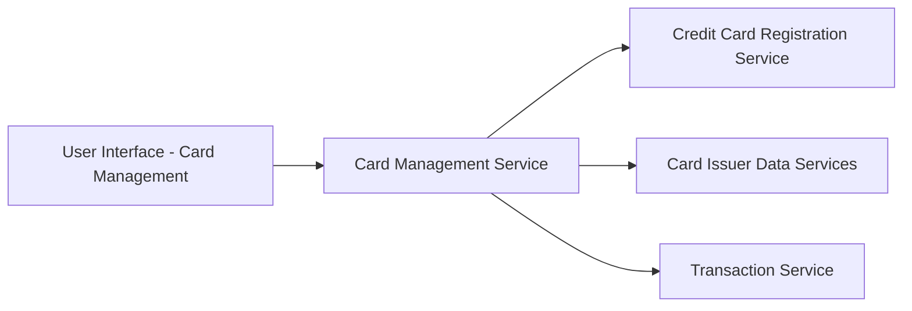

#### 1. High-Level Design

- **Summary:** This epic enables users to view and manage multiple credit cards within a unified interface. Users can access individual card details, perform card-wise spend analysis, compare performance across cards, and seamlessly switch between cards to understand their complete credit card portfolio.

- **Component Flow:**

- **Integration Points:**
  - **Upstream:** Credit Card Registration Service (provides enrolled card data); Card Issuer Data Services (provides card details and status); Transaction Service (provides card-specific spending data)
  - **Downstream:** User interface displaying multi-card portfolio view and card-specific analytics

- **Key Assumptions:** 
  - Card data is cached locally to optimize performance for concurrent multi-card loading; User card limit of 10 is enforced at the service layer.

- **NFR Highlights:** System must support minimum 10 credit cards per user; Card data retrieval must complete within 3 seconds; Interface must maintain performance with concurrent multi-card data loading.

#### 2. Validation Report

- **Requirements Coverage:** The design addresses all scope requirements including multiple credit card display, card-wise spend analysis, individual card detail views, card comparison capabilities, card status indicators, and card selection/switching interface. The architecture integrates with all specified dependencies (registration service, card issuer data services, transaction service) and supports the NFRs for handling 10+ cards with 3-second retrieval time.