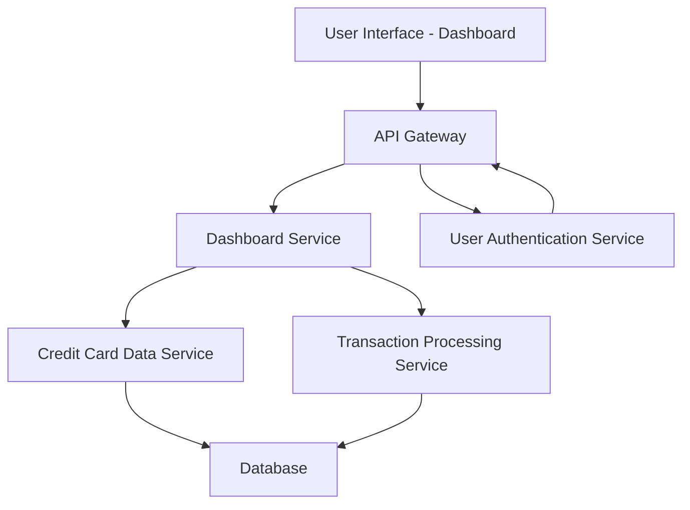

#### 1. High-Level Design

- **Summary:** This epic delivers a consolidated dashboard that displays key performance indicators (KPIs) for a user's credit card portfolio, including monthly spend, total credit limit, available credit, and outstanding amounts. The dashboard provides real-time visibility into overall credit card financial health through a modern, responsive interface accessible across all device types.

- **Component Flow:**

- **Integration Points:**
  - **Upstream:** User Authentication Service (for user identity verification and session management)
  - **Internal:** Credit Card Data Service (retrieves card information, credit limits, balances), Transaction Processing Service (calculates monthly spend and outstanding amounts)
  - **Downstream:** Database (stores credit card data, transaction records, and user profiles)

- **Key Assumptions:**
  - Real-time data refresh is achieved through polling or WebSocket connections with a refresh interval of 30-60 seconds.
  - KPI calculations (available credit, outstanding amounts) are pre-computed and cached to meet the 2-second page load requirement.

- **NFR Highlights:** Dashboard must be responsive across all device types; page load time under 2 seconds; support real-time data refresh.

#### 2. Validation Report

- **Requirements Coverage:** The design fully covers the epic's stated scope by including all required KPI displays (monthly spend, total credit limit, available credit, outstanding amounts), responsive layout implementation, and real-time data refresh capability. The component architecture supports the NFRs through caching strategies for performance and responsive UI frameworks for cross-device compatibility. All identified dependencies (credit card data service, transaction processing service, user authentication service) are integrated into the architecture.