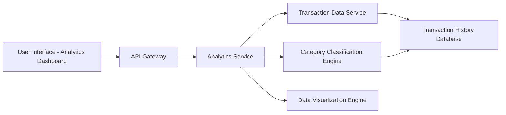

#### 1. High-Level Design

- **Summary:** This epic provides interactive visualizations and analytics for users to understand spending patterns across nine predefined categories (Food & Dining, Fuel, Shopping, Travel, Entertainment, Utilities, Healthcare, Education, Miscellaneous). Users can analyze transaction data through visual representations including charts and graphs, enabling identification of trends and informed financial decision-making.

- **Component Flow:**

- **Integration Points:**
  - **Upstream:** Transaction Data Service (retrieves transaction records for analysis)
  - **Internal:** Category Classification Engine (categorizes transactions into predefined categories), Data Visualization Engine (renders charts and graphs), Transaction History Database (stores 12+ months of transaction data)
  - **Downstream:** Transaction History Database (persistent storage for transaction records)

- **Key Assumptions:**
  - Transactions are auto-categorized using rule-based or ML-based classification; users may have limited ability to recategorize transactions.
  - Analytics data is pre-aggregated by category on a nightly basis to meet the 1-second visualization rendering requirement.

- **NFR Highlights:** Analytics visualizations must render within 1 second; system must handle transaction history of at least 12 months; support concurrent analysis requests from multiple users.

#### 2. Validation Report

- **Requirements Coverage:** The design comprehensively covers the epic's scope including category-wise spending visualization, interactive charts/graphs, transaction categorization, spending pattern analysis, and breakdown across all nine specified categories. The architecture supports the NFRs through data pre-aggregation for 1-second rendering, scalable database design for 12+ months of history, and stateless service design for concurrent user support. All dependencies (transaction data service, category classification engine, data visualization library, transaction history database) are integrated into the solution architecture.