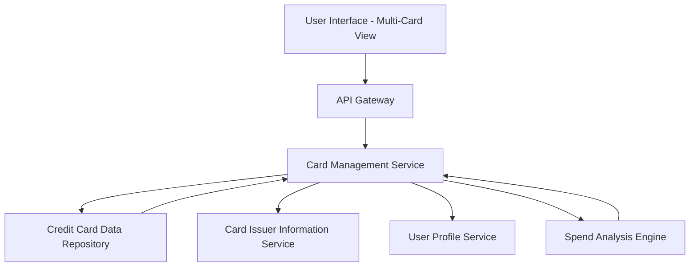

#### 1. High-Level Design

- **Summary:** This epic enables users to manage and view multiple credit cards within a unified interface, displaying card-specific details such as individual credit limits, balances, and usage patterns. Users can compare cards, navigate seamlessly between them, and analyze card-wise spending trends, consolidating their credit card portfolio management into a single view.

- **Component Flow:**

- **Integration Points:**
  - **Upstream:** User Profile Service (associates cards with user accounts)
  - **Internal:** Credit Card Data Repository (stores and retrieves card details, limits, balances), Card Issuer Information Service (provides card issuer metadata), Spend Analysis Engine (computes card-wise spending trends)
  - **Downstream:** Credit Card Data Repository (persistent storage for card information)

- **Key Assumptions:**
  - Card data is cached at the service layer to meet the 500ms retrieval requirement; cache invalidation occurs on data updates.
  - Monthly spend trends are pre-aggregated daily to optimize performance when displaying multiple cards simultaneously.

- **NFR Highlights:** System must support display of at least 10 credit cards per user; card data retrieval must complete within 500ms; UI must maintain performance with multiple cards loaded.

#### 2. Validation Report

- **Requirements Coverage:** The design addresses all scope elements including multiple credit card display, card-wise spend analysis, card detail views, comparison interface, selection/filtering, and monthly spend trends per card. The architecture supports the NFRs through caching strategies for the 500ms retrieval requirement and efficient UI rendering for handling 10+ cards. All dependencies (credit card data repository, card issuer information service, user profile service) are incorporated into the component flow.