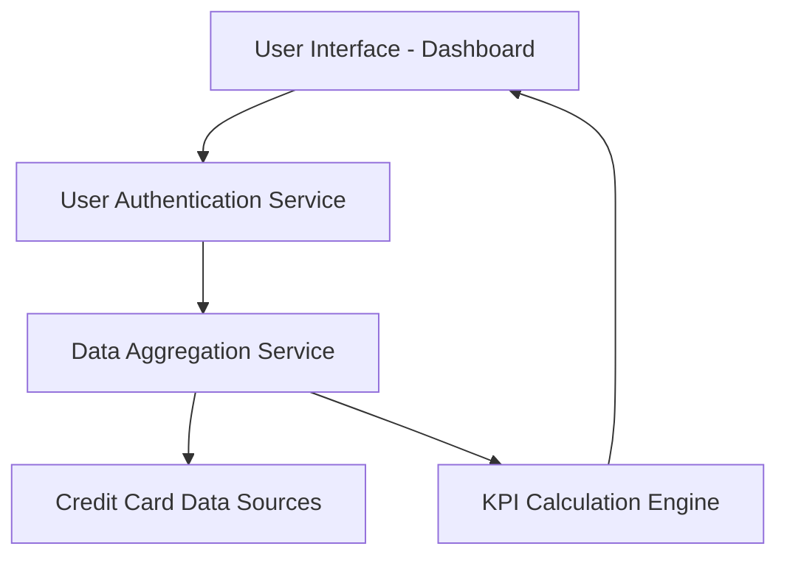

#### 1. High-Level Design

- **Summary:** This epic delivers a centralized dashboard that consolidates financial metrics from multiple credit cards, displaying key performance indicators including monthly spend, total credit limit, available credit, and outstanding amounts. The solution provides real-time visibility into overall credit health through a responsive, single-pane-of-glass interface accessible across devices.

- **Component Flow:**

- **Integration Points:** 
  - **Upstream:** Credit card data sources (for balance and transaction information), User authentication service (for secure access)
  - **Downstream:** Data aggregation service (for multi-card consolidation), KPI calculation engine

- **Key Assumptions:** 
  - Credit card data sources provide standardized API responses with balance, limit, and transaction data
  - Real-time data refresh occurs at intervals sufficient to meet 2-second load time requirement

- **NFR Highlights:** Dashboard must load within 2 seconds, support responsive design for mobile/desktop, handle simultaneous multi-card data refresh, ensure real-time data accuracy

#### 2. Validation Report

- **Requirements Coverage:** The design fully covers the epic's stated scope including monthly spend display, credit limit aggregation, available credit calculation, outstanding amount tracking, multi-card consolidated view, and responsive layout. All NFRs (2-second load time, responsive design, multi-card support, data accuracy) are addressed through the component architecture. Integration dependencies are satisfied through defined service interfaces.