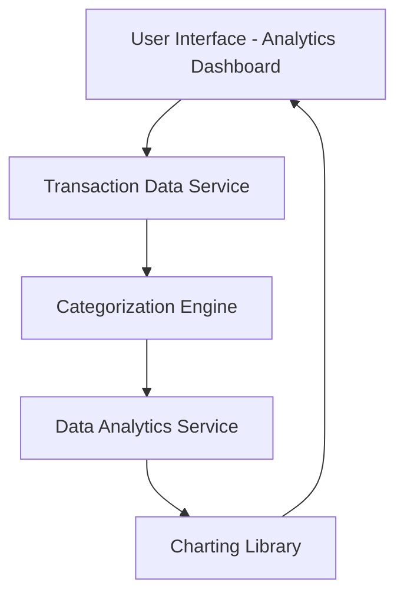

#### 1. High-Level Design

- **Summary:** This epic provides comprehensive spending analytics through interactive visualizations that categorize expenditures across nine predefined categories (Food & Dining, Fuel, Shopping, Travel, Entertainment, Utilities, Healthcare, Education, Miscellaneous). The solution includes monthly trend analysis with interactive charts enabling users to drill down into spending patterns for informed budget management and financial planning.

- **Component Flow:**

- **Integration Points:**
  - **Upstream:** Transaction data service (for raw transaction feeds), Categorization engine (for automatic transaction classification)
  - **Downstream:** Data analytics service (for trend calculation), Charting library (for visualization rendering)

- **Key Assumptions:**
  - Categorization engine uses rule-based or ML-based classification to automatically assign transactions to predefined categories
  - Transaction data includes merchant information sufficient for accurate category classification

- **NFR Highlights:** Analytics must process up to 1000 transactions per month, visualizations render within 3 seconds, support interactive filtering without page reload, ensure accurate category classification

#### 2. Validation Report

- **Requirements Coverage:** The design comprehensively covers all scope requirements including category-wise visualization, monthly spend trends, interactive charts/graphs, spending pattern analysis, nine predefined categories, transaction categorization, and trend comparison. All NFRs (1000 transaction processing, 3-second render time, interactive filtering, classification accuracy) are addressed through the component architecture. Integration dependencies (transaction service, categorization engine, charting library, analytics service) are fully incorporated.