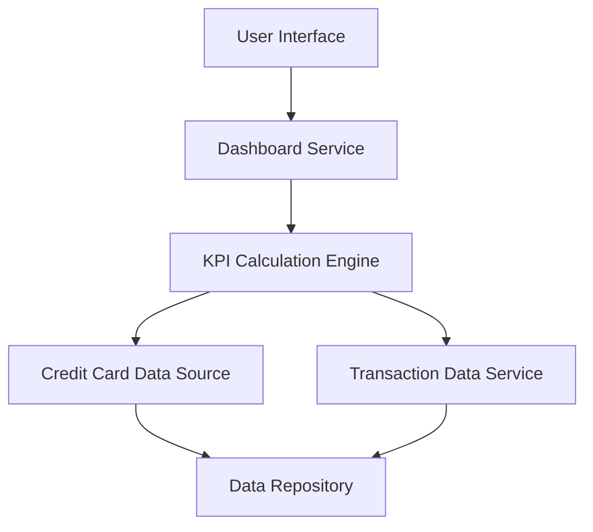

#### 1. High-Level Design

- **Summary:** This epic delivers a consolidated dashboard interface that enables users to view and manage multiple credit cards with key performance indicators including monthly spend, total credit limit, available credit, and outstanding amounts. The dashboard provides a comprehensive overview of credit utilization and financial position to support better financial decision-making.

- **Component Flow:**

- **Integration Points:**
  - **Upstream:** Credit Card Data Source (for card details, credit limits, and balance information)
  - **Upstream:** Transaction Data Service (for calculating monthly spend and outstanding amounts)
  - **Downstream:** User Interface (for displaying dashboard KPIs and card portfolio)

- **Key Assumptions:**
  - Credit card data includes real-time or near-real-time balance and limit information
  - Available credit is calculated as (Total Credit Limit - Outstanding Amount) for each card

- **NFR Highlights:** Dashboard must load and display KPIs within 2 seconds; must support responsive layouts across desktop, tablet, and mobile devices; must support concurrent viewing of multiple credit cards without performance degradation

- **Data Flow:** User accesses dashboard through UI → Dashboard Service invokes KPI Calculation Engine → Engine retrieves card details (limits, balances) from Credit Card Data Source → Engine retrieves transaction data from Transaction Data Service → KPIs are calculated (monthly spend aggregation, total credit limit sum, available credit calculation, outstanding amount totals) → Aggregated KPIs and individual card metrics are returned to Dashboard Service → Dashboard renders responsive layout with KPI widgets and card list → User views real-time financial position across all cards.

#### 2. Validation Report

- **Requirements Coverage:** The design fully addresses all scope elements including dashboard KPIs display, multiple credit card management, monthly spend tracking, total credit limit aggregation, available credit calculation, outstanding amount monitoring, and responsive dashboard layout. All NFRs regarding 2-second load time, responsive design across devices, and concurrent multi-card viewing without performance degradation are supported through the architecture with dedicated KPI Calculation Engine and optimized data retrieval patterns.