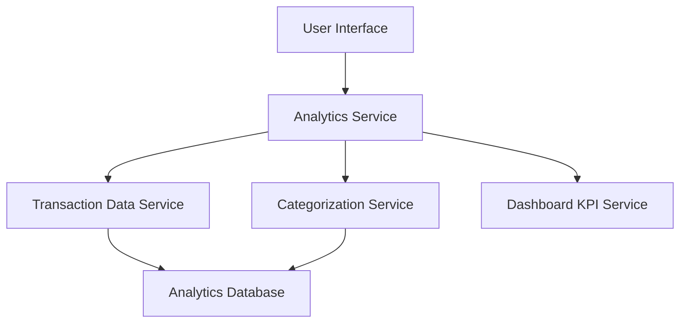

#### 1. High-Level Design

- **Summary:** This epic provides interactive visualizations and analytical capabilities to help users understand spending patterns and financial behavior. It includes monthly spend trend analysis, card-wise spending breakdowns, and category-wise spending analysis across nine categories (Food & Dining, Fuel, Shopping, Travel, Entertainment, Utilities, Healthcare, Education, Miscellaneous).

- **Component Flow:**

- **Integration Points:**
  - **Upstream:** Transaction Data Service (for historical spending data)
  - **Upstream:** Categorization Service/Logic (for assigning transactions to spending categories)
  - **Upstream:** Dashboard KPI Service (for consistent data presentation)
  - **Downstream:** User Interface (for rendering interactive charts and visualizations)

- **Key Assumptions:**
  - Transactions are automatically categorized into the nine predefined categories using business rules or ML-based categorization logic
  - Historical transaction data is available for at least 12 months for trend analysis

- **NFR Highlights:** Visualizations must render within 3 seconds for up to 12 months of data; charts must be interactive and responsive across all device types; analytics calculations must be accurate and consistent with transaction data

- **Data Flow:** User requests analytics view through UI → Analytics Service queries Transaction Data Service for historical spending data → Categorization Service assigns/retrieves category information → Analytics Service aggregates data by month, card, and category → Calculated metrics are cross-validated with Dashboard KPI Service for consistency → Interactive visualizations (line charts for trends, bar/pie charts for breakdowns) are rendered in UI → User interacts with charts to drill down into specific time periods, cards, or categories.

#### 2. Validation Report

- **Requirements Coverage:** The design comprehensively covers all scope elements including monthly spend trend visualization, card-wise spend analysis, category-wise spending breakdown across all nine categories, interactive charts and graphs, and spending pattern identification. All NFRs regarding rendering performance (3 seconds), interactivity, responsiveness, and calculation accuracy are addressed through the service architecture and integration with data sources.