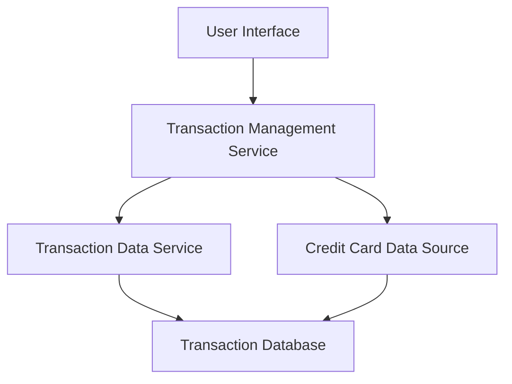

#### 1. High-Level Design

- **Summary:** This epic delivers a transaction management system that enables users to view, track, and monitor all credit card transactions across their portfolio. It provides comprehensive transaction history access, detailed transaction views, and multi-card transaction aggregation capabilities to support financial transparency and spending accountability.

- **Component Flow:**

- **Integration Points:** 
  - **Upstream:** Transaction Data Service (for retrieving transaction records)
  - **Upstream:** Credit Card Data Source (for associating transactions with specific cards)
  - **Downstream:** User Interface (web/mobile clients for displaying transaction data)

- **Key Assumptions:** 
  - Transaction data is pre-categorized and stored with card associations in the data source
  - Transaction retrieval API supports filtering by card, date range, and pagination for efficient data handling

- **NFR Highlights:** System must handle large volumes of transaction data efficiently; transaction data accuracy and consistency across all views; responsive interface on all device types (desktop, tablet, mobile)

- **Data Flow:** User requests transaction data through the UI → Transaction Management Service queries Transaction Data Service and Credit Card Data Source → Services retrieve transaction records and card associations from Transaction Database → Aggregated transaction data with card details is returned to UI → User views transaction list with details including amount, date, merchant, category, and associated card.

#### 2. Validation Report

- **Requirements Coverage:** The design fully covers the epic's stated scope including transaction listing and display, transaction details view, multi-card transaction aggregation, transaction history access, and responsive transaction interface. All NFRs regarding efficient data handling, accuracy, consistency, and responsive design are addressed through the component architecture and integration points.