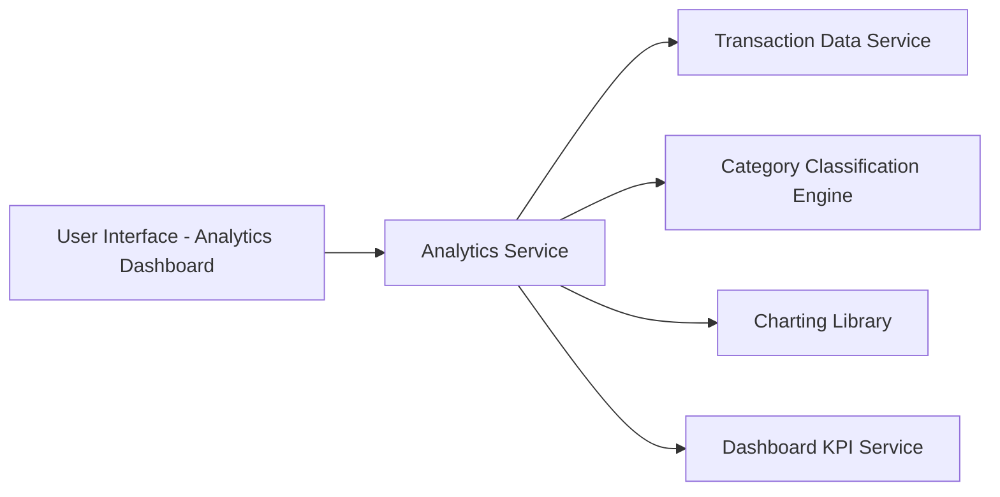

#### 1. High-Level Design

- **Summary:** This epic delivers interactive visualizations and analytics for user spending patterns, including category-wise breakdowns (9 categories: Food & Dining, Fuel, Shopping, Travel, Entertainment, Utilities, Healthcare, Education, Miscellaneous), monthly spend trends, and card-wise spend analysis. The feature processes transaction data to provide actionable insights for financial decision-making.

- **Component Flow:**

- **Integration Points:**
  - **Upstream:** Transaction Data Service (for raw transaction records and metadata)
  - **Internal:** Category Classification Engine (for categorizing transactions into 9 predefined categories)
  - **Internal:** Dashboard KPI Service (for consistent data representation with dashboard epic QE-8346)
  - **External:** Charting Library (e.g., D3.js, Chart.js for rendering interactive visualizations)

- **Key Assumptions:** 
  - Transactions include merchant category codes (MCC) or merchant names for automated category classification. 
  - Analytics data is pre-aggregated in near real-time to meet 1.5-second chart rendering requirement.

- **NFR Highlights:** Chart rendering ≤1.5 seconds; handle ≥1000 transactions/user/month; interactive and responsive visualizations; cent-level accuracy; near real-time updates.

#### 2. Validation Report

- **Requirements Coverage:** The design comprehensively covers all scope elements including category-wise visualization (9 categories), monthly spend trends, card-wise analysis, interactive visualizations, transaction-based analytics, and responsive rendering. The architecture supports the demanding NFRs for performance (1.5-second rendering), scalability (1000+ transactions/month), accuracy (cent-level), and near real-time updates. Integration with transaction data service, category classification engine, dashboard KPI service, and charting library ensures robust analytics capabilities while maintaining consistency with other epics.