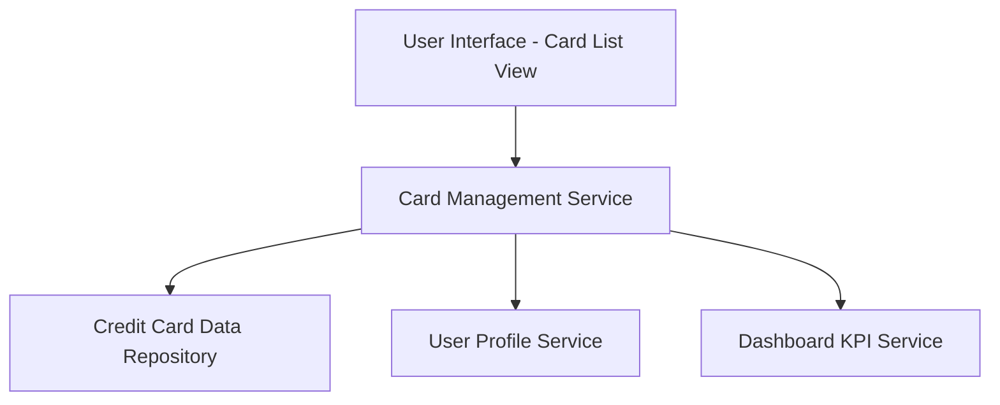

#### 1. High-Level Design

- **Summary:** This epic enables users to view and manage multiple credit cards (minimum 10 per user) within a unified interface. Each card displays individual details including credit limit, outstanding balance, and available credit, providing a comprehensive portfolio view that eliminates the need for multiple banking applications.

- **Component Flow:**

- **Integration Points:**
  - **Upstream:** User Profile Service (for card-user association and user context)
  - **Downstream:** Credit Card Data Repository (for storing and retrieving card information)
  - **Internal:** Dashboard KPI Service (for feeding aggregated metrics to the dashboard epic QE-8346)

- **Key Assumptions:** 
  - Card data is synchronized every 5 minutes via scheduled jobs or event-driven updates. 
  - Card identification uses unique card IDs with masking for security (e.g., last 4 digits display).

- **NFR Highlights:** Support ≥10 cards per user; card data retrieval ≤3 seconds; data sync every 5 minutes; scalable UI for varying card counts.

#### 2. Validation Report

- **Requirements Coverage:** The design addresses all scope items including unified multi-card view, card-specific metrics (credit limit, outstanding balance, available credit), card identification/labeling, and responsive layout. The architecture supports the NFRs for scalability (10+ cards), performance (3-second retrieval), and data synchronization (5-minute intervals). Integration with user profile service and dashboard KPI service ensures proper data flow and aggregation for portfolio-level insights.