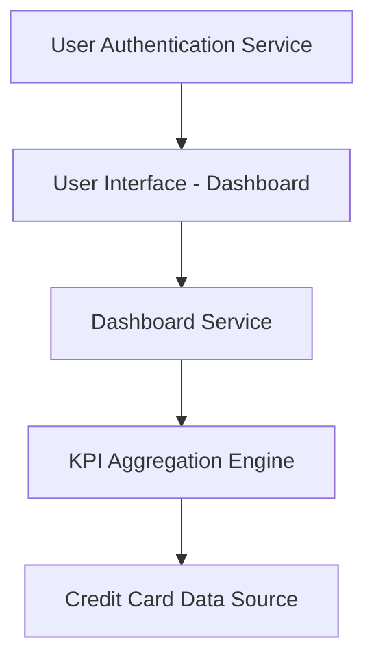

#### 1. High-Level Design

- **Summary:** This epic delivers a centralized dashboard that aggregates and displays critical financial KPIs (Monthly Spend, Total Credit Limit, Available Credit, Outstanding Amount) across all user credit cards in real-time. The dashboard serves as the primary entry point for users to assess their overall credit card portfolio health and make informed financial decisions.

- **Component Flow:**

- **Integration Points:**
  - **Upstream:** User Authentication Service (for secure user access and session management)
  - **Downstream:** Credit Card Data Sources (for real-time balance, transaction, and credit limit information)
  - **Internal:** KPI Aggregation Engine (for calculating consolidated metrics across multiple cards)

- **Key Assumptions:** 
  - Credit card data is available via REST/GraphQL API with sub-second response time. 
  - Data refresh mechanism uses polling or webhook-based push notifications from data sources.

- **NFR Highlights:** Dashboard load time ≤2 seconds; real-time data refresh; responsive UI (desktop/tablet/mobile); 99.9% data accuracy.

#### 2. Validation Report

- **Requirements Coverage:** The design fully covers the epic's stated scope including all four KPIs (Monthly Spend, Total Credit Limit, Available Credit, Outstanding Amount), consolidated view, responsive layout, and real-time data refresh. The architecture supports the NFRs for performance (2-second load), responsiveness, and data accuracy. Integration dependencies with credit card data sources and authentication service are addressed in the component flow.