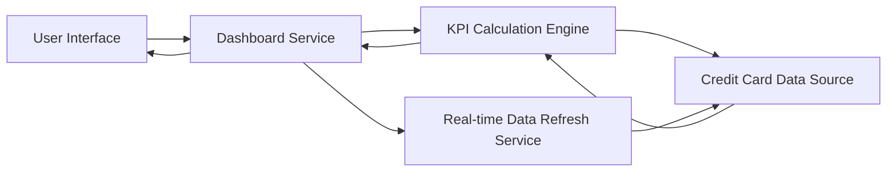

#### 1. High-Level Design

- **Summary**: This epic enables users to view a consolidated dashboard displaying key performance indicators for their credit card portfolio including monthly spend, total credit limit, available credit, and outstanding amounts. Users can monitor multiple credit cards from a single interface with a modern, responsive design that provides real-time visibility into their credit card financial health and spending patterns.

- **Component Flow**:

- **Integration Points**: 
  - **Upstream**: Credit card data source or mock data service (provides card information, transaction data, and balance information)
  - **Internal**: KPI Calculation Engine (aggregates and calculates monthly spend, total credit limit, available credit, outstanding amounts)
  - **Internal**: Real-time data refresh service (enables real-time KPI updates)

- **Key Assumptions**: 
  - KPI calculations are performed server-side with caching to meet the 2-second page load requirement.
  - Real-time refresh is implemented using polling (every 30-60 seconds) or WebSocket connections for push updates.

- **NFR Highlights**: Dashboard must be responsive across desktop, tablet, and mobile devices; Page load time must be under 2 seconds; Real-time data refresh capability for KPIs.

- **Data Flow**: User accesses dashboard → Dashboard Service requests KPI data from KPI Calculation Engine → KPI Calculation Engine retrieves card information, transaction data, and balance information from Credit Card Data Source → Engine calculates Monthly Spend, Total Credit Limit, Available Credit, and Outstanding Amount across all cards → Aggregated KPIs are returned to Dashboard Service → Real-time Data Refresh Service periodically updates KPIs → Dashboard displays consolidated view with all KPIs in a responsive layout optimized for all device types.

#### 2. Validation Report

- **Requirements Coverage**: The design covers all stated scope items including Dashboard KPIs display, Monthly Spend tracking, Total Credit Limit aggregation, Available Credit calculation, Outstanding Amount display, Multiple Credit Cards view, and Responsive layout design. The architecture supports the NFRs for responsive design across all devices, sub-2-second page load time, and real-time data refresh capability. All dependencies (credit card data source or mock data service for card information, transaction data, and balance information) are identified and integrated. The design excludes out-of-scope items (Real Bank Integration, Card Payments, Fund Transfers, Loans, Payment Gateway Integration) as specified.