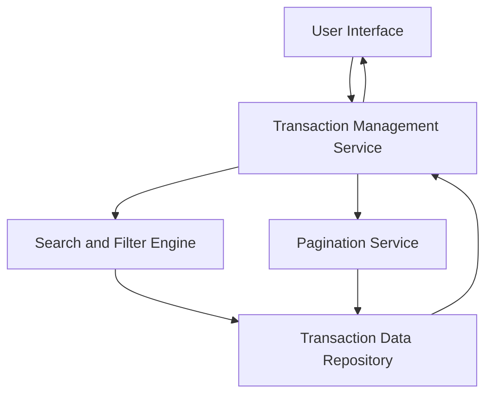

#### 1. High-Level Design

- **Summary**: This epic provides users with comprehensive transaction tracking capabilities across all their credit cards. Users can view, filter, and search through their credit card transactions, enabling them to understand their spending behavior and verify charges. The transaction interface supports multiple cards and provides detailed transaction information in an accessible format with pagination or infinite scroll for large transaction sets.

- **Component Flow**:

- **Integration Points**: 
  - **Upstream**: Credit card data source for transaction history (provides transaction data)
  - **Internal**: Transaction data service or repository (stores and retrieves transaction records)
  - **Internal**: Search and filter engine (enables transaction filtering and search capabilities)

- **Key Assumptions**: 
  - Transaction data is indexed for efficient search and filtering operations to meet the 1-second rendering requirement.
  - Pagination is implemented with page size of 50-100 transactions to optimize performance for large datasets up to 10,000 transactions per user.

- **NFR Highlights**: System must handle display of up to 10,000 transactions per user; Transaction list rendering must complete within 1 second; Support for pagination or infinite scroll for large transaction sets.

- **Data Flow**: User accesses transaction view → Transaction Management Service queries Transaction Data Repository with filters and pagination parameters → Search and Filter Engine applies user-specified criteria (date range, card, amount, merchant) → Pagination Service retrieves the requested page of transactions → Transaction data is returned to User Interface → Detailed transaction information is displayed in a responsive, accessible format with options to load more transactions.

#### 2. Validation Report

- **Requirements Coverage**: The design covers all stated scope items including Transaction listing, Multi-card transaction view, Transaction details display, Transaction search and filtering, and Responsive transaction interface. The architecture supports the NFRs for handling 10,000 transactions per user, 1-second rendering time, and pagination/infinite scroll. All dependencies (transaction data service/repository, credit card data source) are identified and integrated. The design excludes out-of-scope items (Real Bank Integration, Card Payments, Fund Transfers, Payment Gateway Integration, Transaction disputes/chargebacks) as specified.