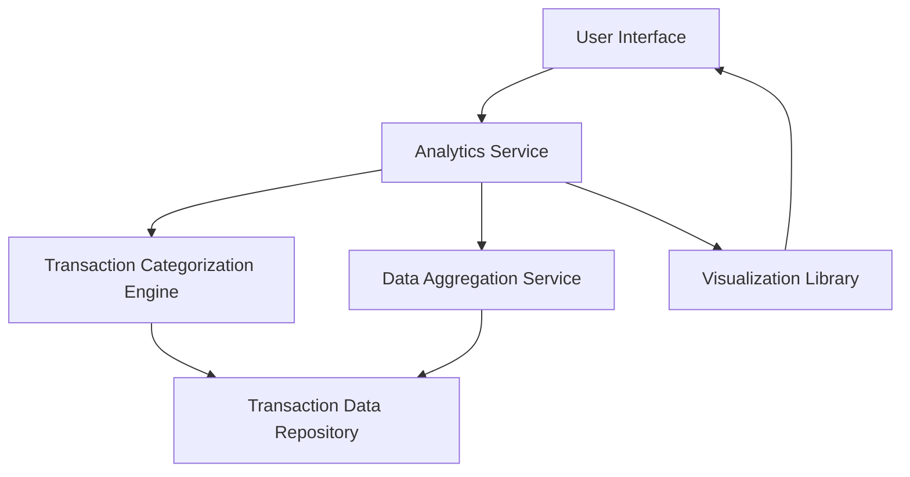

#### 1. High-Level Design

- **Summary**: This epic delivers interactive visualizations and analytics capabilities that help users understand their spending patterns across different categories. Users can analyze monthly spend trends, view card-wise spending breakdowns, and explore category-wise spending distributions across 9 predefined categories (Food & Dining, Fuel, Shopping, Travel, Entertainment, Utilities, Healthcare, Education, and Miscellaneous). The analytics provide actionable insights to help users make informed financial decisions.

- **Component Flow**:

- **Integration Points**: 
  - **Upstream**: Transaction data repository/service (provides raw transaction data)
  - **Internal**: Transaction categorization service or logic (categorizes transactions into 9 predefined categories)
  - **Internal**: Visualization library or charting framework (renders interactive charts)
  - **Internal**: Data aggregation service (aggregates transaction data by category, card, and time period)

- **Key Assumptions**: 
  - Transactions are pre-categorized or a categorization service exists to map transactions to one of the 9 predefined categories automatically.
  - Monthly aggregation is performed server-side with cached results to meet the 1.5-second rendering requirement.

- **NFR Highlights**: Analytics visualizations must render within 1.5 seconds; Support for interactive chart interactions with sub-200ms response time; Charts must be responsive and accessible across all device types.

- **Data Flow**: User requests analytics view → Analytics Service retrieves transaction data from Transaction Data Repository → Transaction Categorization Engine categorizes transactions into 9 predefined categories → Data Aggregation Service aggregates data by month, card, and category → Aggregated data is passed to Visualization Library → Interactive charts are rendered in User Interface with drill-down capabilities for detailed insights.

#### 2. Validation Report

- **Requirements Coverage**: The design covers all stated scope items including Monthly Spend Trends visualization, Card-wise Spend Analysis, Category-wise Spending charts across 9 categories, and Interactive visualizations. The architecture supports the NFRs for rendering performance (1.5s), interaction response time (sub-200ms), and responsive design. All dependencies (transaction categorization service, visualization library, data aggregation service) are identified and integrated into the component flow. The design excludes out-of-scope items (Real Bank Integration, Predictive forecasts, Budget alerts, Custom categories, External exports) as specified.