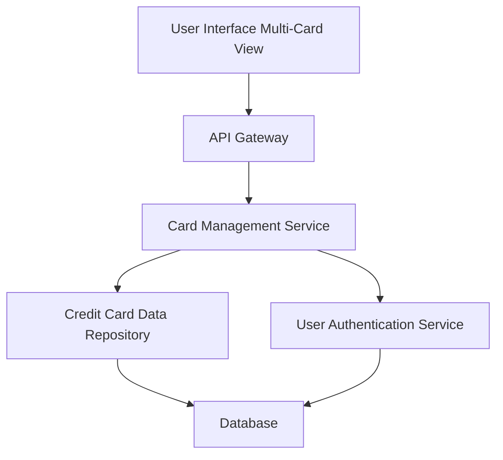

#### 1. High-Level Design

- **Summary**: This epic enables users to manage and monitor multiple credit cards from a unified interface, providing card-specific details, individual limits and balances, card-wise spend analysis, and comparative insights across cards.

- **Component Flow**:

- **Integration Points**: 
  - **Upstream**: Credit card data repository (for storing and retrieving card information), User authentication service (for secure card access)
  - **Downstream**: Multi-card UI with card selection, filtering, and comparison capabilities

- **Key Assumptions**: 
  - Each user can have up to 10 credit cards linked to their account.
  - Card data includes card number (masked), issuer, limit, balance, and transaction summary.

- **NFR Highlights**: System must support viewing and managing at least 10 credit cards per user, card data retrieval must complete within 1 second, UI must be responsive across all device types.

- **Data Flow**: User logs in and is authenticated via the User Authentication Service. The Card Management Service retrieves all linked credit cards from the Credit Card Data Repository. Card details (limits, balances, spend summaries) are fetched and displayed in the UI. User can select individual cards to view detailed information or compare multiple cards side-by-side.

#### 2. Validation Report

- **Requirements Coverage**: The design covers all requirements including multiple credit card display, card-wise spend analysis, individual card details view, card selection and filtering, card comparison capabilities, and responsive card layout. Integration with credit card data repository and user authentication service is addressed. NFRs for supporting at least 10 cards per user, 1-second data retrieval, and responsive UI are supported through efficient data access patterns and responsive design frameworks.