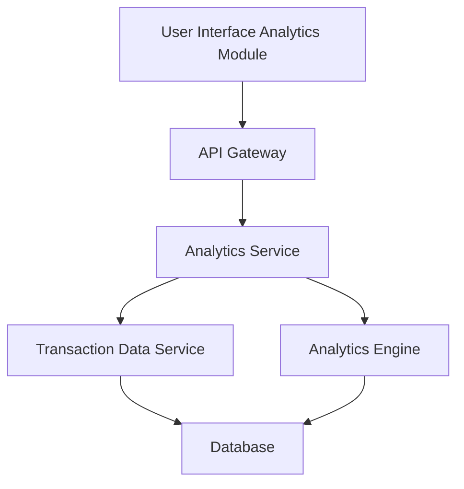

#### 1. High-Level Design

- **Summary**: This epic delivers comprehensive spending analytics with interactive visualizations enabling users to analyze expenses across nine predefined categories (Food and Dining, Fuel, Shopping, Travel, Entertainment, Utilities, Healthcare, Education, Miscellaneous) and view monthly spend trends over time.

- **Component Flow**:

- **Integration Points**: 
  - **Upstream**: Transaction data service (for retrieving categorized transaction history), Analytics engine (for processing and aggregating spending data)
  - **Downstream**: Interactive charts and graphs in the UI

- **Key Assumptions**: 
  - Transactions are pre-categorized by the transaction data service or a classification service.
  - Historical data for at least 12 months is available and accessible for trend analysis.

- **NFR Highlights**: Analytics visualizations must render within 3 seconds, support interactive filtering and drill-down capabilities, handle historical data for at least 12 months.

- **Data Flow**: User accesses the analytics module and selects filters (date range, category, card). The Analytics Service retrieves categorized transaction data from the Transaction Data Service, processes it through the Analytics Engine to aggregate spending by category and time period, and returns visualizations to the UI. Interactive drill-down requests trigger additional queries for detailed breakdowns.

#### 2. Validation Report

- **Requirements Coverage**: The design addresses all requirements including category-wise spending visualization, monthly spend trends, interactive charts and graphs, spending pattern analysis, and category breakdown for all nine specified categories. Integration with transaction data service and analytics engine is included. NFRs for 3-second rendering, interactive filtering, and 12-month historical data handling are supported through the analytics service architecture and efficient data retrieval patterns.