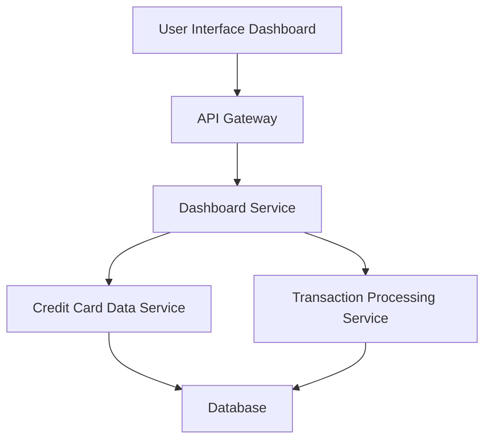

#### 1. High-Level Design

- **Summary**: This epic provides a consolidated dashboard interface that displays critical financial metrics including monthly spending, total credit limit, available credit, and outstanding amounts aggregated across all credit cards. The dashboard enables real-time monitoring of financial health indicators through a responsive UI.

- **Component Flow**:

- **Integration Points**: 
  - **Upstream**: Credit card data service (for fetching card balances and limits), Transaction processing service (for calculating monthly spend and outstanding amounts)
  - **Downstream**: Dashboard UI (responsive web/mobile interface)

- **Key Assumptions**: 
  - Data aggregation logic will calculate totals across all cards in real-time or near-real-time.
  - Credit card data service provides standardized API responses with balance, limit, and transaction data.

- **NFR Highlights**: Dashboard must load within 2 seconds, support responsive layouts across desktop and mobile devices, handle real-time data refresh for KPI updates.

- **Data Flow**: User accesses the dashboard UI, which sends requests through the API Gateway to the Dashboard Service. The Dashboard Service queries the Credit Card Data Service for card balances and limits, and the Transaction Processing Service for monthly spend and outstanding amounts. Data is retrieved from the Database, aggregated, and returned to the UI for display as KPIs.

#### 2. Validation Report

- **Requirements Coverage**: The design covers all stated requirements including monthly spend display, total credit limit calculation, available credit tracking, outstanding amount monitoring, dashboard UI layout, and responsive design. Integration with credit card data service and transaction processing service is accounted for. NFRs for 2-second load time and responsive design are addressed through service-oriented architecture and UI framework selection.