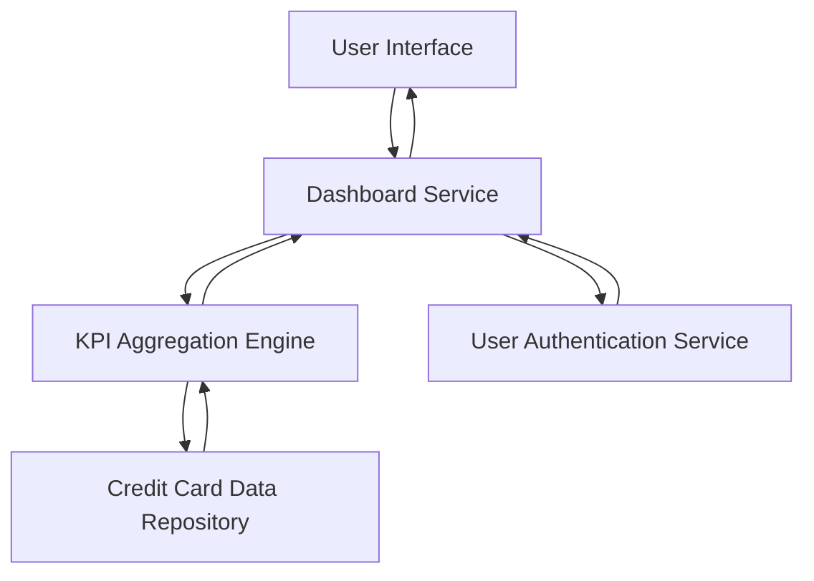

#### 1. High-Level Design

- **Summary:** This epic delivers a centralized dashboard that provides users with real-time visibility into key credit card metrics including monthly spend, total credit limit, available credit, and outstanding amounts across all their credit cards. The solution enables consolidated financial monitoring and decision-making through a modern, responsive interface accessible across multiple devices.

- **Component Flow:**

- **Integration Points:**
  - **Upstream:** User Authentication Service (for user identity verification and session management)
  - **Downstream:** Credit Card Data Source/Repository (for retrieving card details, balances, limits, and transaction data)

- **Key Assumptions:** 
  - Credit card data is updated in near real-time or at regular intervals (e.g., hourly) by an external process not covered in this epic.
  - KPI calculations (available credit, outstanding amounts) follow standard financial formulas: Available Credit = Total Limit - Outstanding Amount.

- **NFR Highlights:** Dashboard must load within 2 seconds; must support responsive design across mobile, tablet, and desktop devices; must comply with WCAG 2.1 accessibility standards.

#### 2. Validation Report

- **Requirements Coverage:** The design fully covers the epic's stated scope including dashboard KPI display, monthly spend tracking, credit limit aggregation, available credit calculation, outstanding amount monitoring, responsive UI design, and multi-card consolidated view. All specified NFRs (2-second load time, responsive design, WCAG 2.1 compliance) are addressed. Integration dependencies with credit card data repository and user authentication service are identified and incorporated into the component flow.