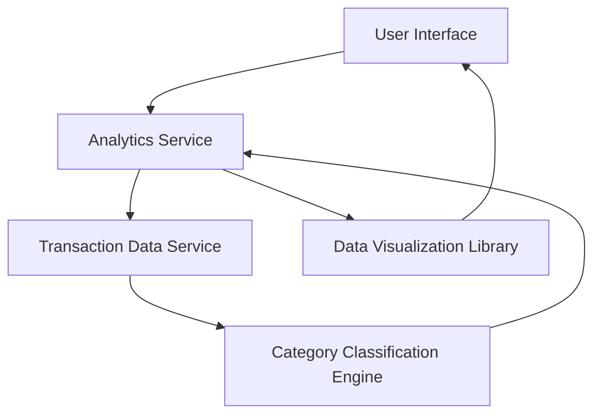

#### 1. High-Level Design

- **Summary:** This epic provides interactive visualizations and analytics capabilities that enable users to understand spending patterns through category-wise analysis across 9 predefined categories (Food & Dining, Fuel, Shopping, Travel, Entertainment, Utilities, Healthcare, Education, Miscellaneous). The solution delivers actionable insights through interactive charts and graphs that help users identify spending patterns and optimize expenses, handling up to 1000 transactions per user per month.

- **Component Flow:**

- **Integration Points:**
  - **Upstream:** Transaction Data Service (for retrieving raw transaction data)
  - **Downstream:** Category Classification Engine (for categorizing transactions into predefined categories), Data Visualization Library (for rendering interactive charts and graphs)

- **Key Assumptions:**
  - Transactions are pre-categorized by the Category Classification Engine or categorization occurs in real-time during data retrieval.
  - The 9 predefined categories are fixed and cover all transaction types; uncategorized transactions default to "Miscellaneous."

- **NFR Highlights:** Analytics visualizations must render within 2 seconds; system must handle and categorize at least 1000 transactions per user per month; charts must be interactive and responsive across all devices.

#### 2. Validation Report

- **Requirements Coverage:** The design fully addresses the epic's scope including category-wise spending visualization, transaction listing, interactive charts and graphs, spending pattern analysis, multi-category support for 9 predefined categories, and monthly spend trend analysis. All NFRs are incorporated (2-second render time, 1000 transactions/user/month capacity, interactive and responsive charts). Integration dependencies with transaction data service, category classification engine, and data visualization library are properly identified and integrated into the component architecture.