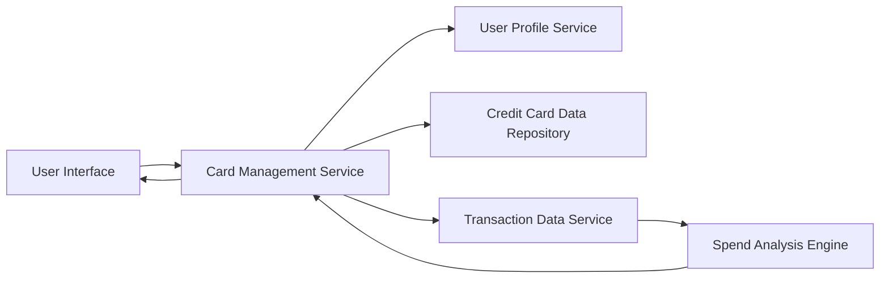

#### 1. High-Level Design

- **Summary:** This epic enables users to manage and view multiple credit cards (up to 10 per user) within a unified interface. Users can access individual card details, limits, balances, and card-wise spend analysis to understand spending patterns across different cards. The solution provides both individual card views and portfolio-level oversight for users managing multiple credit cards for different purposes.

- **Component Flow:**

- **Integration Points:**
  - **Upstream:** User Profile Service (for user identity and card ownership verification)
  - **Downstream:** Credit Card Data Repository (for retrieving card details, limits, and balances), Transaction Data Service (for accessing transaction history and spend data)

- **Key Assumptions:**
  - Card ownership is validated through the User Profile Service before displaying card details.
  - Monthly spend trends are calculated based on transaction data aggregated by calendar month.

- **NFR Highlights:** System must support at least 10 credit cards per user; card data refresh must occur within 3 seconds; data integrity must be maintained across all card operations.

#### 2. Validation Report

- **Requirements Coverage:** The design comprehensively addresses all scope items including multiple credit card display, card-wise spend analysis, individual card details view, card-specific balance tracking, card-specific limit display, and monthly spend trends per card. All NFRs are incorporated (10-card support, 3-second refresh, data integrity). Integration dependencies with credit card data repository, user profile service, and transaction data service are properly identified and reflected in the architecture.