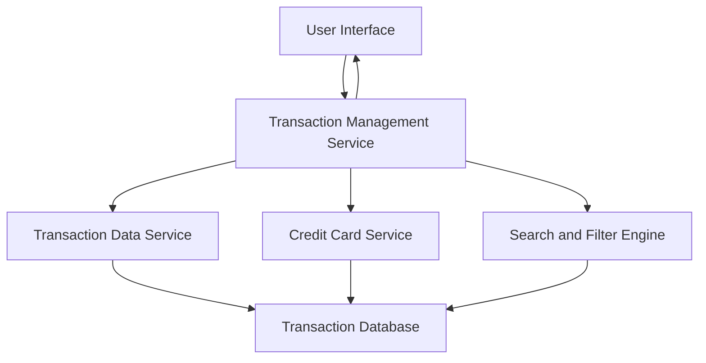

#### 1. High-Level Design

- **Summary:** This epic provides users with comprehensive transaction management capabilities, enabling them to view, search, and analyze all credit card transactions across their multiple cards. Users can access detailed transaction histories, filter by date ranges, and track spending activities. The feature ensures transparency and helps users maintain awareness of their spending behavior across all credit cards, supporting better financial management and fraud detection.

- **Component Flow:**

- **Integration Points:**
  - **Upstream:** Transaction data service (retrieves transaction records from database), Credit card service (provides card-specific filtering and transaction association)
  - **Downstream:** Transaction UI (displays transaction list, details, and search results)
  - **Internal:** Search and Filter Engine (handles date range filtering, keyword search, and multi-card aggregation)

- **Key Assumptions:**
  - Transactions are stored with standardized metadata (merchant name, category, amount, date, card ID) to enable efficient search and filtering.
  - Pagination is implemented with page size of 50 transactions per page to balance performance and usability.

- **NFR Highlights:** Transaction list must support pagination for large datasets; search and filter operations must complete within 1 second; system must handle at least 10,000 transactions per user.

- **Data Flow:** User requests transaction list through UI → Transaction Management Service queries Transaction Data Service for transactions across all user's cards → Transaction Database returns transaction records → Search and Filter Engine applies user-specified filters (date range, card, keyword) → Paginated results are returned to Transaction Management Service → Transaction list with details is displayed to user → User can drill down into individual transaction details or refine search/filter criteria.

#### 2. Validation Report

- **Requirements Coverage:** The design fully addresses the epic's scope including transaction listing, transaction details view, multi-card transaction aggregation, transaction search and filtering, transaction history access, and responsive transaction interface. All NFRs are satisfied: pagination support for large datasets (10,000+ transactions per user) through efficient database indexing and query optimization, sub-1-second search and filter operations through indexed search engine, and scalability to handle 10,000 transactions per user through proper database design and caching strategies. Dependencies on transaction data service and credit card service are properly integrated and aligned with the architecture.