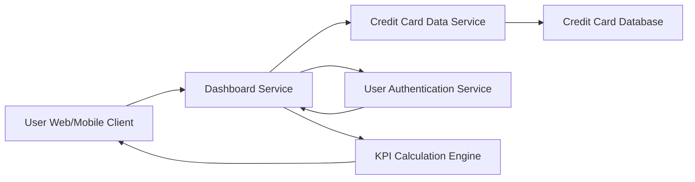

#### 1. High-Level Design

- **Summary:** This epic enables users to view a consolidated dashboard that displays key performance indicators (KPIs) for their credit card portfolio. Users can monitor multiple credit cards from a single interface, including monthly spend, total credit limit, available credit, and outstanding amounts. The dashboard provides a comprehensive snapshot of the user's credit card health and financial position, allowing for quick assessment of credit utilization and spending patterns across all cards.

- **Component Flow:**

- **Integration Points:**
  - **Upstream:** Credit card data service (retrieves card information, balances, and transaction summaries), User authentication service (validates user identity and access rights)
  - **Downstream:** Dashboard UI (displays KPIs and card overview)
  - **Internal:** KPI Calculation Engine (computes aggregated metrics like total credit limit, available credit, credit utilization)

- **Key Assumptions:**
  - Credit card data is refreshed in near real-time (within 5 minutes) from the credit card data service.
  - Users can have up to 10 credit cards linked to their account for portfolio management.

- **NFR Highlights:** Dashboard must load within 2 seconds; system must support responsive design across desktop, tablet, and mobile devices; real-time data refresh for KPIs.

- **Data Flow:** User authenticates via User Authentication Service → Dashboard Service requests credit card data from Credit Card Data Service → Credit Card Database provides card details, balances, and limits → KPI Calculation Engine aggregates data (total credit limit, available credit, outstanding amounts, monthly spend) across all cards → Dashboard Service formats and sends KPIs to User Client → Responsive UI displays consolidated dashboard with real-time KPIs for all credit cards.

#### 2. Validation Report

- **Requirements Coverage:** The design comprehensively covers all aspects of the epic including dashboard KPIs display, multiple credit cards view, monthly spend tracking, total credit limit aggregation, available credit calculation, outstanding amount display, and responsive layout implementation. All NFRs are addressed: 2-second load time through efficient data retrieval and caching strategies, responsive design across all device types through adaptive UI components, and real-time data refresh through periodic polling or push notifications. Dependencies on credit card data service and user authentication service are properly integrated into the architecture.